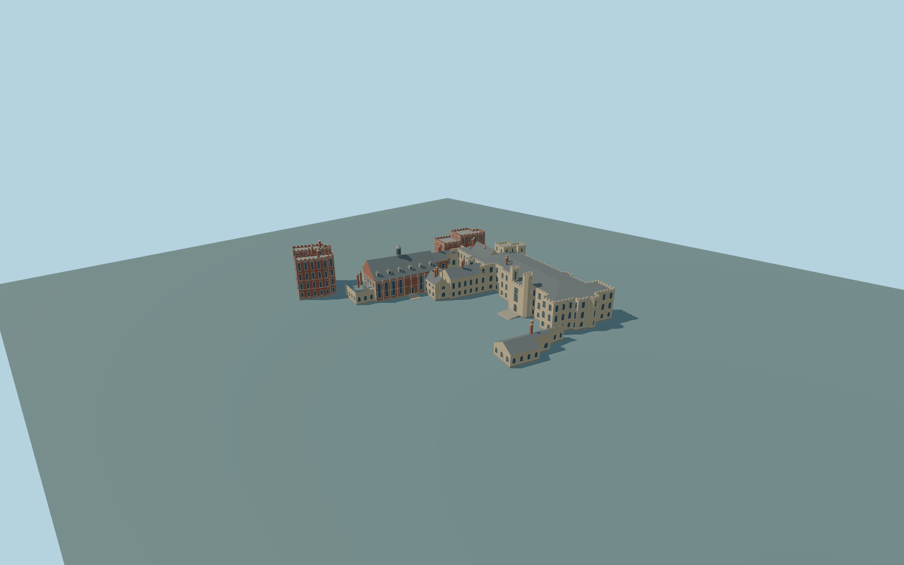

# Lambeth Palace

Complete individual historic principal Lambeth Palace exterior: warm-stone Blore residential range with projecting entrance and paired polygonal turrets, red-brick western towers and Great Hall, chapel and returned cloister ranges, the integral separately mapped Morton twin gatehouse, and the low eastern court-edge range. Preserve the small cloister court, open main forecourt, recessed closed main and side gates, and closed window glazing. Original simplified trim; copied heraldry, sculpture, inscriptions and interiors are excluded. Garden Museum/church, detached modern library, shared church-side link, gardens and independent cottages remain native context.

Rebuild: `node packages/worldgen/scripts/generate-lambeth-palace.mjs`;append `--check` for exact source bytes. Select import/LOD/placement with `--ids=lambeth_palace`. Detailed source and four browser tiers are separate ignored GLB outputs.

Complete individual historic principal Lambeth Palace exterior: warm-stone Blore residential range with projecting entrance and paired polygonal turrets, red-brick western towers and Great Hall, chapel and returned cloister ranges, the integral separately mapped Morton twin gatehouse, and the low eastern court-edge range. Preserve the small cloister court, open main forecourt, recessed closed main and side gates, and closed window glazing. Original simplified trim; copied heraldry, sculpture, inscriptions and interiors are excluded. Garden Museum/church, detached modern library, shared church-side link, gardens and independent cottages remain native context.

Approximate standard global Terrarium datum 4 m, with common exterior floor 4.8 m. Two unchanged global tiles supply the field. Native gatehouse height 17 m and principal-parent height 14 m guide overall massing; inspected ordinary pictures guide individual tower, roof and window proportions where native height parts are incomplete. Three bounded supported approaches meet the sampled field. Heights and historic grades are approximate.

Three ordinary pictures were inspected: broad oblique aerial, residential courtyard facade and gatehouse front. Rear inventories, concealed joins, exact window counts, roof details, original trim and historic grades are medium-fi approximations. The shared church-side link remains native. Reference pictures stay local and are not textures. Physical device timings and numerical LOD errors remain unmeasured.

Seven existing shared 256px limestone, brick, granite, slate, painted-metal, wood and window-grid graphs serve eight material slots. Metric UVs and linear colors; no private or embedded images. Skyline preserves all main groups while simplifying small parapet details. District uses window and merlon proxies. Street has closed recesses and simpler pointed arches; close-up adds parapet thickness, mullions, buttress trim and roof detail. The detailed master preserves finer framing and arch curves.

Original geometry:repository license. Map:© OpenStreetMap contributors,ODbL-1.0;Protomaps. Standard terrain:terrain-grid.json. Ordinary pictures stay local and are not redistributed or used as textures. Current acceptance:qa.json.
