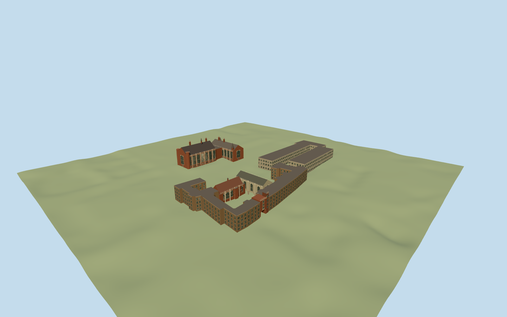

# Lincoln's Inn

Lincoln’s Inn’s Victorian Great Hall and Library, medieval Old Hall, raised Gothic chapel, Tudor Gatehouse and Georgian Stone Buildings.

Authoring state: **review-in-qa.json**. Current completion evidence is in [qa.json](qa.json) and the [completion ledger](../../../../qualla-structures/batches/qualla-003.PROGRESS.md).

- [Lincoln's Inn](https://qualla.com/lincoln-s-inn/)

Primary named structures and the adjoining Old Buildings are within scope. Other chambers, modern underground facilities, New Square and detached park structures remain part of base Earth context.

Not all small parts have independent surveyed outlines. The Gatehouse’s return, late roof profiles, Stone Buildings court facades and fenestration are rationalized against the mapped blocks and historical sources.

The Great Hall and Library share a mapped outer footprint. Their joining structures, lead and slate roof segmentation, individual stained glass and heraldic panel details are approximated.

Build: `node content/worldgen/source/places/gc/gcp/lincoln_s_inn/models/generate-lincoln-s-inn.mjs`. Add `--check` to verify exact regeneration. 19193 triangles; 6 materials; no embedded photographs.
