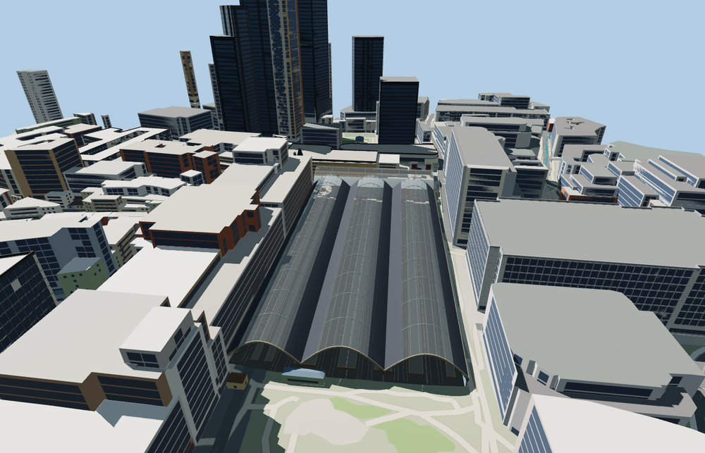

# Liverpool Street station

Victorian iron and glass train sheds open toward Exchange Square. The raised concourse and three stairways lead to ten platform bodies. The Bishopsgate canopy and brick clock towers frame the east entrance, and a modern glass portal serves Broadgate.

The 83,406-triangle source rebuilds byte for byte. Skyline, district, street and close-up use 879, 3,819, 14,574, 57,672 triangles. Skyline and district total 402,312 bytes. Six GLBs validated and 38 current views were inspected.

The model replaces seven mapped station parts and preserves 575 surrounding buildings and 859 transportation records. All four tiers pass checks for nine open doorway samples, fifteen stair treads, three roof crests, ten platform surfaces, seventeen surface rail lanes and four surrounding terrain samples. Ground, water and landcover restore on unload.

The model represents the existing station and its above-ground public circulation. Future redevelopment, temporary roof works, train animation and underground platforms are outside this model. Track centerlines and platform footprints follow PMTiles. Three eastern tracks are reconstructed from mapped platform stops and the parallel track alignment where centerlines are absent. Roof sections, gables and internal elevations are photo-based reconstructions. The upper entrances fit standard terrain samples and the tracks use an estimated lower station datum. Neighboring commercial and hotel buildings remain independent map objects. Their station-side approaches share the fitted station terrain cutout.

Rebuild with `node packages/worldgen/scripts/generate-liverpool-street-station.mjs`. Append `--check` to compare exact bytes. Use `--ids=liverpool_street_station` for targeted import, LOD, placement and readiness.
