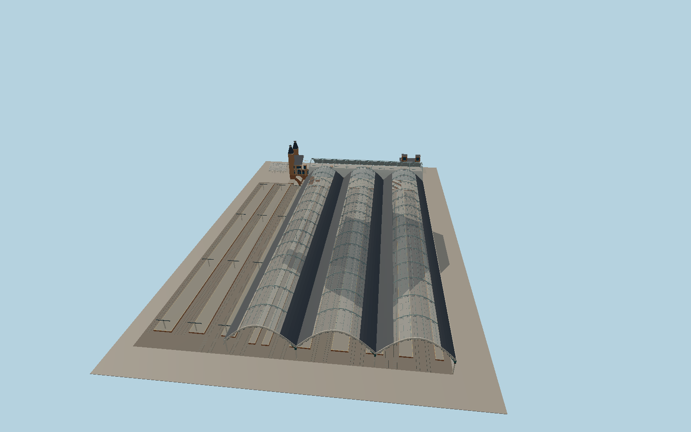

# Liverpool Street station

Victorian iron and glass train sheds open toward Exchange Square. The raised concourse and three stairways lead to ten platform bodies. The Bishopsgate canopy and brick clock towers frame the east entrance, and a modern glass portal serves Broadgate.

Run `node packages/worldgen/scripts/generate-liverpool-street-station.mjs` to rebuild the source master. Append `--check` to compare the exact bytes. Use `--ids=liverpool_street_station` for targeted import, LOD generation and placement.

The model represents the existing station and its above-ground public circulation. Future redevelopment, temporary roof works, train animation and underground platforms are outside this model.

Track centerlines and platform footprints follow PMTiles. Three eastern tracks are reconstructed from mapped platform stops and the parallel track alignment where centerlines are absent.

Roof sections, gables and internal elevations are photo-based reconstructions. The upper entrances fit standard terrain samples and the tracks use an estimated lower station datum.

Neighboring commercial and hotel buildings remain independent map objects. Their station-side approaches share the fitted station terrain cutout.

Original geometry follows the repository license. Map data is © OpenStreetMap contributors under ODbL-1.0 via Protomaps. Terrain samples are described in terrain-grid.json. Local photographs serve as visual references for the authored geometry. Current acceptance is recorded in qa.json.
