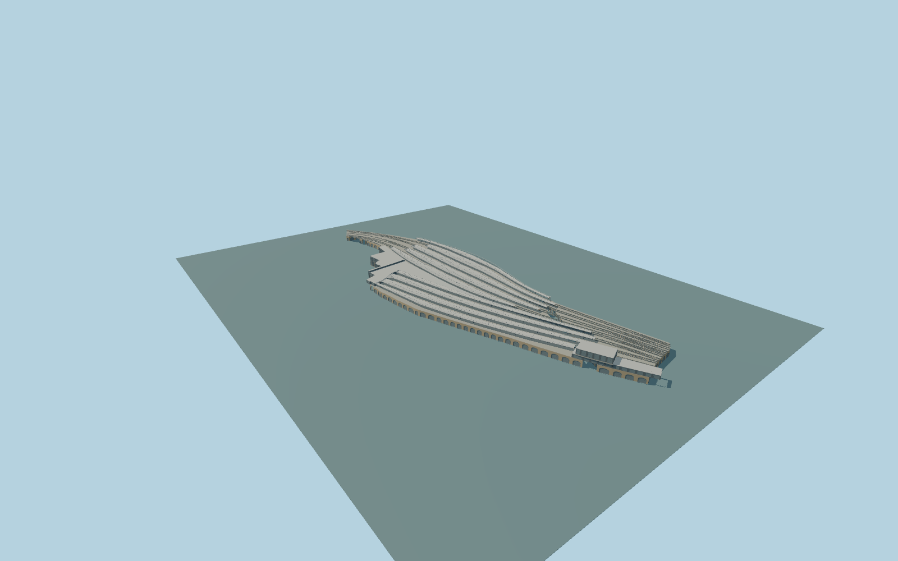

# London Bridge station

Whole permanent connected London Bridge station exterior:allnine complete curving pale/silver map-shaped platformroof ribbons,woodsoffits,Ysupports,mappedabovegroundmainline railbeds ontheelevateddeck,modern two-levelbrick/glass Tooleyfront withrecesseddoors andglassawnings,western headhouse,brickviaductshoparches,pictured openoldentrywithsteeltruss andSSE elevatedhousing/returns. Preserve actualmappedroadtunnels andopenrailapproaches;keepTheShard,ShardPlace/NewsBuilding,offices,cityblocks andstreets separate. Exterioronly;no lettering,brands,people,trains,navigableinterior orfutureexpansion.

Rebuild: `node packages/worldgen/scripts/generate-london-bridge-station.mjs`;append `--check` for exact source bytes. Select import/LOD/placement with `--ids=london_bridge_station`. Detailed source and four browser tiers are separate ignored GLB outputs.

Whole permanent connected London Bridge station exterior:allnine complete curving pale/silver map-shaped platformroof ribbons,woodsoffits,Ysupports,mappedabovegroundmainline railbeds ontheelevateddeck,modern two-levelbrick/glass Tooleyfront withrecesseddoors andglassawnings,western headhouse,brickviaductshoparches,pictured openoldentrywithsteeltruss andSSE elevatedhousing/returns. Preserve actualmappedroadtunnels andopenrailapproaches;keepTheShard,ShardPlace/NewsBuilding,offices,cityblocks andstreets separate. Exterioronly;no lettering,brands,people,trains,navigableinterior orfutureexpansion.

Native maxima/stacks remain explicit:parent11m isownership,roofribbons12m,lowerbodies/deck8m,westernranges14m andSSE housing19/min12m. Map min7/8/12m facts are retained. Floor+.65m,decksurface8m,rooftrough11.1m/eaves12m,soffitthickness,foundations-8m andfine profile/support/archinventory arearchitectural approximations. Lowerconcourse isinterpreted betweenX-160/-75 clippedtotheparent plusmappedwesternheadhouse;onlythoseclosedfloorplans receivegroundmasks. Mainrail/viaductfloor is elevated8m,notartificialground. Standard-maproad/path tunnels crossingthedeck haveexplicit approximate-widthclearances;thepictured westernentry hasaphoto-proportionedopenportal. Nevermask thoseapproaches ormove parts independently. Railbeds copyonlycurrentaboveground mainline railsegments;Underground/tunnelrail lines areexcluded. One unchanged standard field sample outside the modern Tooley Street entry[-120,-80],3.715097m,defines commonY=0. Native contact still requires current render review.

Three ordinary current/completed-station aerial,oldentry andmodernfacade pictures inspected. Hiddeninterior/concourse extent,exactthresholds,platformlevels,railgauge/bed details andsupport/archinventory areunverified approximations. Current PMTiles supplieswholeplans andallstatedheightfacts. No bespoke survey/geodata research andno furtherphotosrequired. Exact hidden windows,thresholds,roof section/rib inventory andcurrent works remain approximate. Physical-device timing andnumerical LODerrors remainunmeasured.

Seven existing shared256px graphs:brick,stone_limestone,concrete_plain,metal_standing_seam,wood_plain,metal_painted andwindow_grid. Seven mergedsemanticgroups;metricUVs,linearcolors,noembedded/privateimages. Realbuffbrick,palemetal,warmwoodsoffits,stone/concrete andactualglazing retainmaterialsemantics. Skyline preserveswholemap-shapedribbons,headhouse,elevateddeck andSSEhousing. Districtaddscoarseglazing,roofprofiles andabovegroundtrackbeds;streetaddsactualrecesses andYsupports;close-uprefinesframes,cladding/soffits,railheads andtruss. Separatemasterrefinesroofcurves,roofseams,reveals,tracks andarches. No copied labels/numerals/brands. Exacthiddeninventory remains approximate.

Original geometry:repository license. Map:© OpenStreetMap contributors,ODbL-1.0;Protomaps. Standard terrain:terrain-grid.json. Ordinary pictures stay local and are not redistributed or used as textures. Current acceptance:qa.json.
