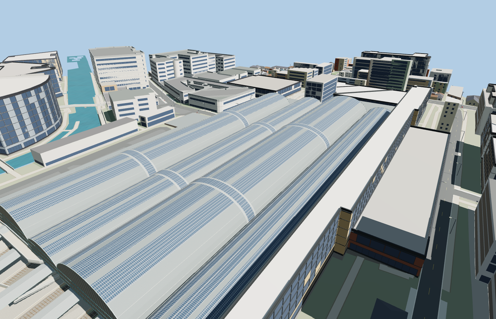

# London Paddington station

Four longitudinal glazed train sheds rise above the curved platforms at Paddington. The roof retains the two transverse strips, varied vault heights and iron end screens. The track approach has raised platforms, thin canopies, a track fan and open clearance beneath the ironwork.

The 74,047-triangle source rebuilds byte for byte. Skyline, district, street and close-up use 599, 2,975, 8,755, 37,855 triangles. Skyline and district total 289,308 bytes. Six GLBs validated and 36 current views were inspected.

All four tiers pass four roof crest, four roof underside, eight platform floor, 24 track clearance and three concourse probes. The viewer retains 370 independent building records and 574 transportation records. Failed loading restores both station footprints.

The main station footprint and platform edges come from PMTiles. Vault heights, the steelwork pattern and the concourse are scaled exterior reconstructions from photographs. Track pairs between the mapped platforms are approximate and terminate inside the site model. The separately mapped hotel, streets, Underground and canal remain independent. Interiors beyond the visible platforms and concourse edge are outside the reconstruction.

Rebuild with `node packages/worldgen/scripts/generate-paddington-station.mjs`. Append `--check` to compare exact bytes. Use `--ids=london_paddington_station` for targeted import, LOD, placement and readiness.
