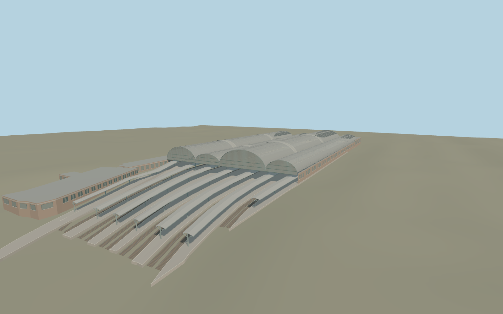

# London Paddington station

Four longitudinal glazed train sheds rise above the curved platforms at Paddington. The roof retains the two transverse strips, varied vault heights and iron end screens. The track approach has raised platforms, thin canopies, a track fan and open clearance beneath the ironwork.

Run `node packages/worldgen/scripts/generate-paddington-station.mjs` to rebuild the source master. Append `--check` to compare the exact bytes. Use `--ids=london_paddington_station` for targeted import, LOD generation and placement.

The main station footprint and platform edges come from PMTiles. Vault heights, the steelwork pattern and the concourse are scaled exterior reconstructions from photographs.

Track pairs between the mapped platforms are approximate and terminate inside the site model. The separately mapped hotel, streets, Underground and canal remain independent. Interiors beyond the visible platforms and concourse edge are outside the reconstruction.

Original geometry follows the repository license. Map data is © OpenStreetMap contributors under ODbL-1.0 via Protomaps. Terrain samples are described in terrain-grid.json. Ordinary pictures stay local and are not redistributed or used as textures. Current acceptance is recorded in qa.json.
