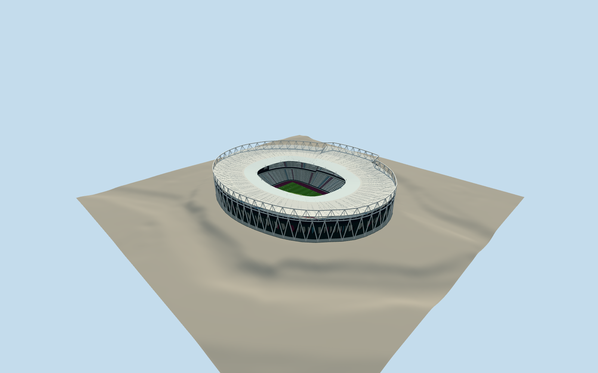

# London Stadium

London Stadium’s white compression truss and V-columns enclose a football pitch and two seating tiers on its Olympic Park island.

Authoring state: **review-in-qa.json**. Current completion evidence is in [qa.json](qa.json) and the [completion ledger](../../../../qualla-structures/batches/qualla-003.PROGRESS.md).

- [London Stadium](https://qualla.com/london-stadium/)

The model depicts the current football layout. Seat counts, interface details, facade pattern and interior service areas are simplified.

The outer and inner roof outlines are mapped. Vertical roof section, cable positions and truss dimensions are original approximate geometry.

The panel artwork, stadium signage, crowd, temporary concert fixtures, and separate nearby buildings and bridges are outside the modeled scope.

Build: `node content/worldgen/source/places/gc/gcp/london_stadium/models/generate-london-stadium.mjs`. Add `--check` to verify exact regeneration. 53733 triangles; 8 materials; no embedded photographs.
