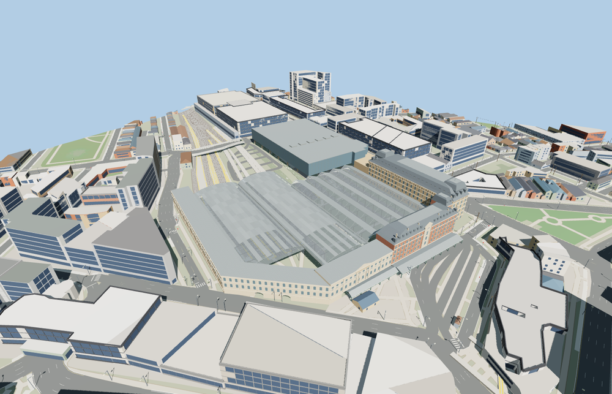

# London Victoria Station

The two London Victoria headhouses face Terminus Place beneath a clock gable and long canopy. The Clermont Hotel mansard, western sawtooth roofs, two eastern barrel sheds and Victoria Place overbuild frame separate boarding islands and open rail lanes.

The 54,294-triangle source rebuilds byte for byte. Skyline, district, street and close-up use 988, 3,680, 13,836, 47,958 triangles. Skyline and district total 428,496 bytes. Six GLBs validated and 37 current views were inspected.

The model replaces six mapped station and hotel features and preserves 604 surrounding buildings and 729 transportation records. The four tiers pass checks for ten entrance bays, 24 open rail samples, nine boarding surfaces, both barrel crests and three clearance points beneath the overbuild. All six mapped buildings return if loading fails.

The terminal frontages, roof envelopes and overbuild follow the station relation and mapped building parts. Smaller dimensions, facade ornament and roof framing are exterior photo reconstructions. Platforms are representative boarding surfaces fitted between mapped rail alignments. PMTiles marks some surface rails beneath Victoria Place as tunnels. The native review preserves these records and renders the above-ground station without standalone tunnel bores. The review covers station exterior, open entrance bays and sheds, and the street-side hotel facade. Shop and hotel interiors, tracks outside the mapped station, and temporary platforms or works are outside the model scope.

Rebuild with `node packages/worldgen/scripts/generate-london-victoria-station.mjs`. Append `--check` to compare exact bytes. Use `--ids=london_victoria_station` for targeted import, LOD, placement and readiness.
