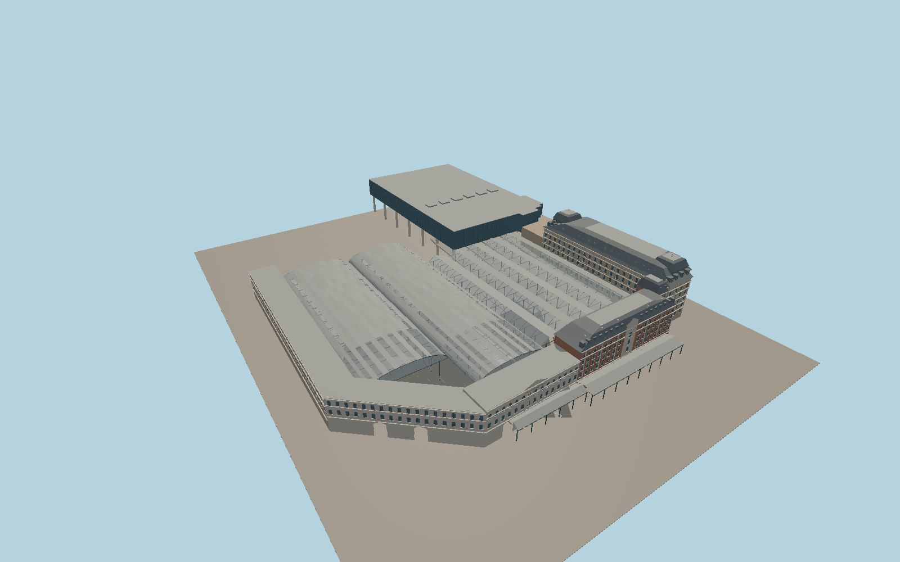

# London Victoria Station

The two London Victoria headhouses face Terminus Place beneath a clock gable and long canopy. The Clermont Hotel mansard, western sawtooth roofs, two eastern barrel sheds and Victoria Place overbuild frame separate boarding islands and open rail lanes.

Run `node packages/worldgen/scripts/generate-london-victoria-station.mjs` to rebuild the source master. Append `--check` to compare the exact bytes. Use `--ids=london_victoria_station` for targeted import, LOD generation and placement.

The terminal frontages, roof envelopes and overbuild follow the station relation and mapped building parts. Smaller dimensions, facade ornament and roof framing are exterior photo reconstructions.

Platforms are representative boarding surfaces fitted between mapped rail alignments. PMTiles marks some surface rails beneath Victoria Place as tunnels. The native review preserves these records and renders the above-ground station without standalone tunnel bores.

The review covers station exterior, open entrance bays and sheds, and the street-side hotel facade. Shop and hotel interiors, tracks outside the mapped station, and temporary platforms or works are outside the model scope.

Original geometry follows the repository license. Map data is © OpenStreetMap contributors under ODbL-1.0 via Protomaps. Terrain samples are described in terrain-grid.json. Ordinary pictures stay local and are not redistributed or used as textures. Current acceptance is recorded in qa.json.
