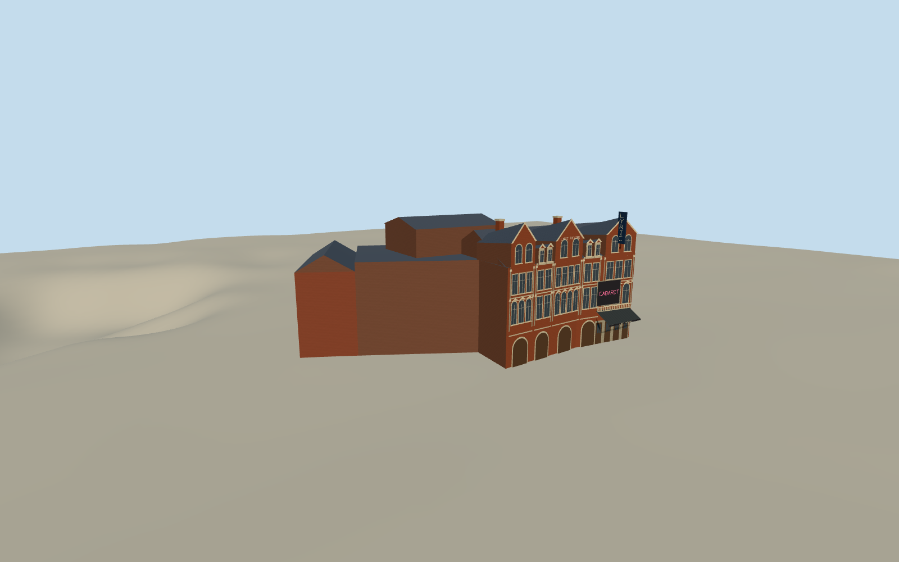

# Lyric Theatre, London

The Lyric Theatre as photographed in 2007, with its brick and stone Shaftesbury Avenue front, slate roofs, theatre canopy and retained Hunter house on Great Windmill Street.

Authoring state: **review-in-qa.json**. Current completion evidence is in [qa.json](qa.json) and the [completion ledger](../../../../qualla-structures/batches/qualla-003.PROGRESS.md).

- [Lyric Theatre, London](https://qualla.com/lyric-theatre-london/)

The April 2007 original guides the photographed brick and stone front, gables, canopied entrance, blade and advertising board. Its signs and carved detail are simplified.

The stage is behind the retained Hunter house. The unpictured stage and auditorium roof profiles, parapets, service openings and relative heights are approximated from the mapped plan and written record.

The elevation field is unchanged. Pavement contacts are estimates sampled from the original elevation tiles.

Build: `node content/worldgen/source/places/gc/gcp/lyric_theatre_london/models/generate-lyric-theatre-london.mjs`. Add `--check` to verify exact regeneration. 4708 triangles; 6 materials; no embedded photographs.
