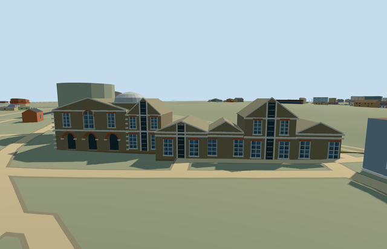

# meridian_building_royal_observatory_greenwich — Meridian Building, Royal Observatory Greenwich

Reviewed2026-10-22. **Completed medium-fi exterior with approximate native placement; Observatory collection remains3/7.**

## Built and inspected

Connected Meridian/Transit House and Telescope Gallery range: four mapped parent footprints/seven owned records, six roof bands, gables/pediments, static black transit shutters with pale strips, stock-brick walls and red window arches, sash lights/white string courses, small silver cap on a closed raised base, three real north entrance recesses with curved soffits. Three ordinary photographs plus the existing PMTiles extract guided one author/inspect/fix pass. Corrected the small cap from the western bay to the eastern transit/galleries junction after comparing roof sequence; no copied lettering/banners or courtyard artifacts.

## Shared materials and browser LODs

Five existing256px graphs: brick stock walls/base and red arches, stone_limestone_raw white trim, slate as an explicit brown weathered-tile substitute, metal_painted lead cap/static shutters/frames, storefront opaque glass. Six textured draws and one skyline draw. No new graph/private atlas/embedded image. Metric surfaces/linear tints, shared graph cache and separate POSITION/NORMAL streams used. All textured native runs read each graph once; every LOD unload disposes all model geometry.

| Level | Triangles | Bytes | Draws |
| --- | ---: | ---: | ---: |
| skyline | 950 | 88312 | 1 |
| district | 3798 | 361428 | 6 |
| street | 7130 | 688432 | 6 |
| closeup | 7610 | 725228 | 6 |

Four authored LODs950 /3798 /7130 /7610 triangles, within1k/4k/16k/64k caps. Initial skyline+district geometry449740 bytes; near levels add sash bars, arches and trim. Six GLBs with zero Khronos errors/warnings,90 actual mesh/contact probes and nine actual PMTiles14/15 overlap cases, seven detailed owned records; no matching13 record. Inspected48 current portable/shared/medium-fi/native frames with all four LODs, failed loading, Economy/High and noon/late-light views. Physical device/dense-city timings remain pending.

## Geographic placement

Approximate native exterior placement accepted. Shared campus Q192988 and declared way268533454/native35184640622286 named Telescope Gallery; contiguous way268533446 is named The Transit House and ways268533457/459 extend east. Three western building parts supply height bands. Own map anchor[-0.001634086041206935,51.47782434984716], heading0 with east/south axes baked in. Uncovered north approach control[25.5,-3], datum46.555058333333335m, floor0.2m above control. Boundary grade -1.24..+0.34m leaves a modest base/slight uphill burial. Replaces only seven owned records, preserving all1295 independent resident/1832 wider buildings including earlier Observatory assets, Great Equatorial dome, detached southwest annex way268533460 and every other principal member. Original201x201/6m terrain, roads and9681.379312m² water retained. Occupied floor cut only; north court/provider/approach remain original. Failed loading retains all1302 originals; every LOD unload restores ground/water with zero live geometry. Exact terraces/thresholds and accessibility unverified.

## Fidelity and limits

Photo-led medium-fi exterior. Mapped5m/8m overall tags are unqualified; working low eaves3.65m/ridges5m, transit eaves5.6m/ridges8m, east eaves6.2m/ridge8m and silver cap to9.1m are reconstructed. Small cap is placed behind the eastern transit/galleries junction from photographed roof sequence, without mapped survey control; precise position/profile remains approximate. Shutter/window/arch inventories, pediments, hidden ends/rear and roof connections simplified. Slate is a shared substitute for weathered tiles. No operating shutters/instruments, furnished rooms, copied signs/lettering, surveyed Prime Meridian strip, exact historic engineering or certified walking access. Great Equatorial dome and remaining campus structures have independent assets/placements; this member does not complete the Observatory.

## Targeted checks

Selected generation/import/placement, strict medium-fi, scene/sim30 and recipe lint pass. Sim30 sha256:9190beb9cbcd2e17ca8db01005864daf17c2e371c7802e91464964e5f124a9f7. Collection tests11+4 passed earlier in this Observatory round. Pins: [qa.json](qa.json); [source controls](map-frame.json).

## Viewed references

- https://commons.wikimedia.org/wiki/File:Royal_Observatory_Greenwich_-_28-Inch_Telescope_Dome_and_Meridian_Building_(8128815256).jpg — Elliott Brown; 2012-10-14; CC-BY-2.0. Viewed only; no copied pixels.

- https://commons.wikimedia.org/wiki/File:Royal_Observatory_Greenwich_-_28-Inch_Telescope_Dome_and_Meridian_Building_(8128692377).jpg — Elliott Brown; 2012-10-14; CC-BY-2.0. Viewed only; no copied pixels.

- https://commons.wikimedia.org/wiki/File:Prime_meridian_003.jpg — Hans Bezard; 2014-04-22; CC-BY-SA-4.0. Viewed only; no copied pixels.

- https://www.openstreetmap.org/way/268533454 — declared Telescope Gallery footprint and contiguous Transit House ranges, ©OpenStreetMap contributors ODbL-1.0. Standard PMTiles/Mapzen, no bespoke terrain research.

## Completion checklist

- [x] Source rebuild, import, four authored LODs and existing shared materials.
- [x] Current actual source/shared/native views, geometry and lifecycle checks.
- [x] Independent identity, map orientation and approximate hillside placement.
- [ ] Four other required Observatory members.
