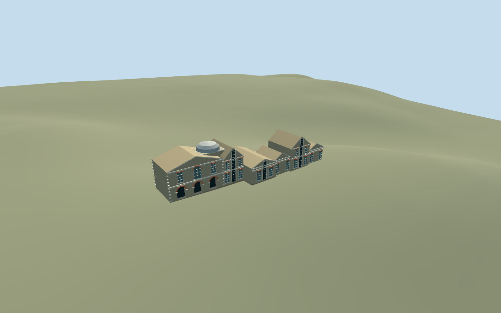

# Meridian Building, Royal Observatory Greenwich

Connected Meridian/Transit House and Telescope Gallery range: mapped western transit rooms and three contiguous eastern ranges, gabled roofs/pediments, dark vertical transit shutters, low tile-colored side galleries, small silver roof cap, white cornices/string bands, stock-brick walls/red window arches, north triple-arched recessed entrance and sash lights. Keep independent Great Equatorial dome, detached southwest annex way268533460, Flamsteed House, eastern pavilion and other campus members. No mathematical Prime Meridian strip is embedded in this building.

## Evidence and reconstruction

Published dimensions and reconstructed details are separated in spec.json. Primary references:

- [Reference](https://commons.wikimedia.org/wiki/File:Royal_Observatory_Greenwich_-_28-Inch_Telescope_Dome_and_Meridian_Building_(8128815256).jpg)
- [Reference](https://commons.wikimedia.org/wiki/File:Royal_Observatory_Greenwich_-_28-Inch_Telescope_Dome_and_Meridian_Building_(8128692377).jpg)
- [Reference](https://commons.wikimedia.org/wiki/File:Prime_meridian_003.jpg)

Connected Meridian/Transit House and Telescope Gallery range: mapped western transit rooms and three contiguous eastern ranges, gabled roofs/pediments, dark vertical transit shutters, low tile-colored side galleries, small silver roof cap, white cornices/string bands, stock-brick walls/red window arches, north triple-arched recessed entrance and sash lights. Keep independent Great Equatorial dome, detached southwest annex way268533460, Flamsteed House, eastern pavilion and other campus members. No mathematical Prime Meridian strip is embedded in this building.

## Model and axes

7,610 triangles; 21,538 vertices; 6 material groups; 870,564 bytes. Native bounds: -8.940, -1.388, -4.555 to 31.630, 9.300, 7.425. Source hash: `sha256:268011c3249bfa6400e5401e9839d0f52c2663d794fef5f516b26e5d4b253374`.

{"x":"east","y":"up","z":"south"}

The geographic proposal uses exact-QID OpenStreetMap evidence. Map-derived orientation and estimated architectural details require real-site visual review; preview eligibility is distinct from geographic/fidelity approval. Map attribution: © OpenStreetMap contributors, ODbL-1.0.

## Reproduce

Run `node packages/worldgen/scripts/generate-additional-landmarks.mjs --ids=meridian_building_royal_observatory_greenwich` (or add `--check`). The generator preserves manually edited masters by checking their baseline hashes. Import through the standard authored-model workflow with optimization disabled; then capture all QA cameras, including shared-surface views.

## Pending work

- Connected Meridian/Transit House and Telescope Gallery range: mapped western transit rooms and three contiguous eastern ranges, gabled roofs/pediments, dark vertical transit shutters, low tile-colored side galleries, small silver roof cap, white cornices/string bands, stock-brick walls/red window arches, north triple-arched recessed entrance and sash lights. Keep independent Great Equatorial dome, detached southwest annex way268533460, Flamsteed House, eastern pavilion and other campus members. No mathematical Prime Meridian strip is embedded in this building.
- Shared campus Q192988 plus declared way268533454/native35184640622286, named Telescope Gallery. Contiguous way268533446/native35184640622278 is named The Transit House; ways268533457/459 continue east toward the separate Great Equatorial building. Integral parts1459032942/943/944 supply western8m/5m/5m bands. Own anchor raw[-17,1], internalX east,Z south, heading0 baked into native coordinates. Only these seven records are owned; retain separate dome way268533517 and southwest annex way268533460.
- Mapped8m central west part/eastern ranges and5m low parts/link are unqualified overall controls. Working low eaves3.65m/ridges5m, central transit eaves5.6m/ridges8m, east eaves6.2m/ridge8m and small photo-led silver cap to9.1m. The small silver cap is reconstructed behind the eastern transit/galleries junction after comparing the north and south pictures. Its precise position is not mapped. Other roof/shutter/window/arch inventories and hidden elevations are reconstructed. Brown-tinted shared slate substitutes for weathered tiles. No furnished instruments/interiors, active shutters, copied lettering/banners or certified Prime Meridian survey alignment.
- Existing Protomaps20261020/Mapzen201x201/6m Observatory extract. Uncovered north approach internal[25.5,-3], datum46.555058333333335m; floor0.2m above control. Closed foundation follows original minimum footprint grade; occupied floor cut only, preserving courtyard/provider, roads/water and independent buildings. Approximate exterior native fit reviewed2026-10-22; boundary grades -1.24..+0.34m relative to the north approach leave a modest downhill base and slight uphill plinth burial. Exact historic terraces/thresholds and accessibility remain approximate.

This bundle follows the medium-fi standard. Medium-fi appearance and geographic fit are reviewed separately. Hash-bound visual acceptance is recorded separately after capture inspection.
