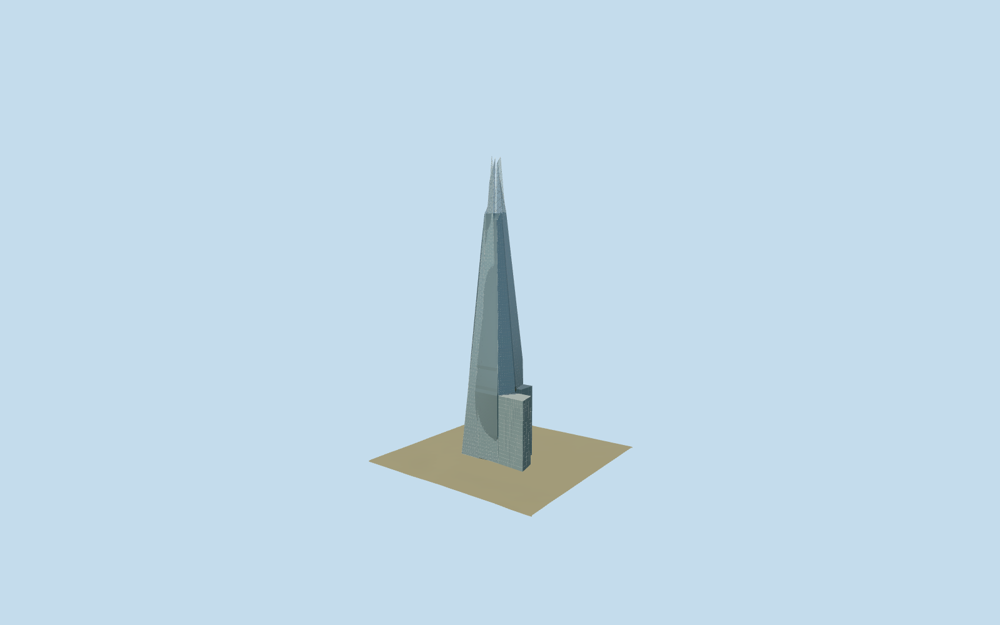

# The Shard

Compact Shard exterior preserves all eight independently mapped facade planes, their unequal tips, recessed enclosure, exposed crown steel and eastern podium. Coarser tiers merge panel grids; original detailed master remains reproducible.

## Evidence and reconstruction

Published dimensions and reconstructed details are separated in spec.json. Primary references:

- [Reference](https://www.the-shard.com/about/)
- [Reference](https://www.the-shard.com/about/level-guide)
- [Reference](https://www.permasteelisagroup.com/historic-project/the-shard/)
- [Reference](https://www.macegroup.com/projects/the-shard/)
- [Reference](https://www.arup.com/projects/the-shard/)

No third-party geometry, photograph or bitmap texture is embedded. Shared surface graphs come from the central library; vertex tints carry model colors. Glazing uses PBR materials; transparent surfaces are declared per model.

## Model and axes

63,187 triangles; 189,561 vertices; 3 material groups; 7,584,676 bytes. Native bounds: -43.493, 0.000, -30.671 to 43.457, 309.652, 30.671. Source hash: `sha256:317d512e8713443ea728ac58c94e329424504c928f1b7f0c1a14b3272b769cef`.

{"up":"+Y","longitudinal":"+X along the cached mapped building frame","front":"+Z toward the long southern edge in that frame","origin":"Exact-QID outer-envelope rectangle center at ground level; eight independently mapped facade planes retain their individual peaks"}

One inspected operator aerial exterior photograph confirms the pointed glass pyramid, separated facade edges and visibly open steel crown. Preserve original309.6m top control, eight independently mapped sloping planes with unequal tips, shifted occupied center and70/74m eastern podium wings. Existing exact-QID outer frame and facade parts establish the signed orientation; standard viewer PMTiles confirms the London Bridge road/building context. Off-footprint PMTiles point[-60,0]4.2538m sets approximate terrain contact; center3.0748m remains coarse. Raw heights are separate from a bounded preview contact correction. Exact glass bay schedule, tip fabrication, steel sections and entrances remain approximations. Separate station blocks and interiors excluded.

## Reproduce

Run `node packages/worldgen/scripts/generate-signature-towers.mjs --ids=N0141` (or add `--check`). The generator preserves manually edited masters by checking their baseline hashes. Import through the standard authored-model workflow with optimization disabled; then capture all QA cameras, including shared-surface views.

## Pending work

- One inspected operator aerial exterior photograph confirms the pointed glass pyramid, separated facade edges and visibly open steel crown. Preserve original309.6m top control, eight independently mapped sloping planes with unequal tips, shifted occupied center and70/74m eastern podium wings. Existing exact-QID outer frame and facade parts establish the signed orientation; standard viewer PMTiles confirms the London Bridge road/building context. Off-footprint PMTiles point[-60,0]4.2538m sets approximate terrain contact; center3.0748m remains coarse. Raw heights are separate from a bounded preview contact correction. Exact glass bay schedule, tip fabrication, steel sections and entrances remain approximations. Separate station blocks and interiors excluded.
- Shared painted-metal graph and reusable opaque/translucent glass PBR; no photographic images. Far tiers keep separated tips and podium while coarsening glass bays and exposed bracing. Physical-device timings pending.

This bundle follows the medium-fi standard. Medium-fi appearance and geographic fit are reviewed separately. Hash-bound visual acceptance is recorded separately after capture inspection.
