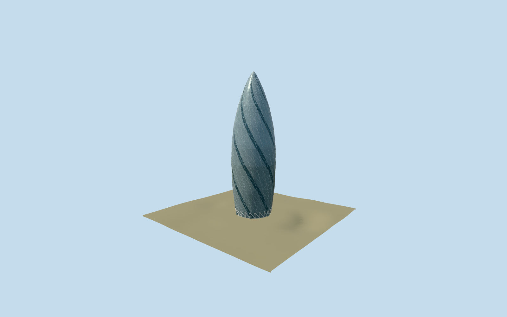

# 30 St Mary Axe

Budgeted curved skin retains the full silhouette, spiral tint bands and lower entrance pods; detail tiers restore facade lines and structural diagonals.

## Evidence and reconstruction

Published dimensions and reconstructed details are separated in spec.json. Primary references:

- [Reference](https://thegherkin.com/)
- [Reference](https://thegherkin.com/availability/)
- [Reference](https://www.arup.com/globalassets/downloads/insights/t/tall-buildings-rising-to-the-net-zero-challenge/tall-buildings-rising-to-the-net-zero-challenge_arupv2-1.pdf)

No third-party geometry, photograph or bitmap texture is embedded. Shared surface graphs come from the central library; vertex tints carry model colors. Glazing uses PBR materials; transparent surfaces are declared per model.

## Model and axes

50,732 triangles; 152,196 vertices; 3 material groups; 6,090,228 bytes. Native bounds: -28.523, -0.105, -28.519 to 28.523, 180.029, 28.519. Source hash: `sha256:5e124fd1e7d1ce6554f91a4eb20fb5035fc8fa0788bd5aa2b6984971fda0b16f`.

{"up":"+Y","longitudinal":"+X along the mapped building long axis","front":"+Z through one of six repeated entrances","origin":"Ground-level center of exact-QID mapped footprint frame"}

Retain180m height,56.6m widest diameter and the authored circular ground envelope from existing exact-QID controls. Inspected exterior pictures support the rounded tapered crown, six dark spiral bands and silver diagrid. Standard viewer PMTiles supplies approximate street/building fit; rotational facade phase remains approximate within sixfold symmetry. Off-footprint[-70,0] sets approximate ground contact, raw PMTiles heights stay separate from bounded radius40m preview correction. Door locations, member sections, glass colors and facade phase remain reconstructed.

## Reproduce

Run `node packages/worldgen/scripts/generate-signature-towers.mjs --ids=N0149` (or add `--check`). The generator preserves manually edited masters by checking their baseline hashes. Import through the standard authored-model workflow with optimization disabled; then capture all QA cameras, including shared-surface views.

## Pending work

- Retain180m height,56.6m widest diameter and the authored circular ground envelope from existing exact-QID controls. Inspected exterior pictures support the rounded tapered crown, six dark spiral bands and silver diagrid. Standard viewer PMTiles supplies approximate street/building fit; rotational facade phase remains approximate within sixfold symmetry. Off-footprint[-70,0] sets approximate ground contact, raw PMTiles heights stay separate from bounded radius40m preview correction. Door locations, member sections, glass colors and facade phase remain reconstructed.
- Shared granite/painted-metal graphs and opaque glass PBR; no copied picture textures. Curved facade and spiral phase approximate. Far tiers merge facade grids; closer tiers retain diagrid. Physical-device timing pending.

This bundle follows the medium-fi standard. Medium-fi appearance and geographic fit are reviewed separately. Hash-bound visual acceptance is recorded separately after capture inspection.
