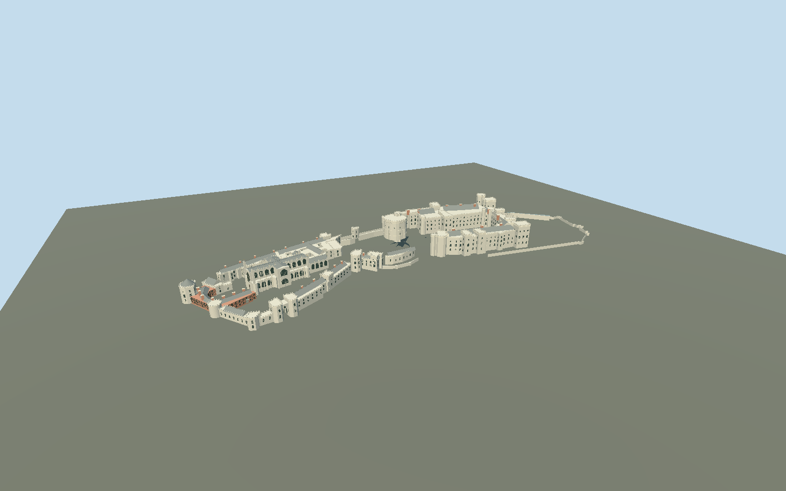

# Windsor Castle

Individually arranged Upper, Middle and Lower Wards: mapped palace ranges and named towers, open quadrangle, Round Tower and artificial motte, Saint George’s and Albert Memorial chapels, timber-and-brick Horseshoe Cloister and Henry VIII gateway.

## Evidence and reconstruction

Published dimensions and reconstructed details are separated in spec.json. Primary references:

- [Reference](https://www.rct.uk/visit/windsor-castle/who-built-windsor-castle)
- [Reference](https://historicengland.org.uk/listing/the-list/list-entry/1117776)
- [Reference](https://www.openstreetmap.org/way/23580556)
- [Reference](https://commons.wikimedia.org/wiki/File:Aerial_view_of_Windsor_Castle.jpg)
- [Reference](https://commons.wikimedia.org/wiki/File:Windsor_Castle_Upper_Ward_Quadrangle_Corrected_2-_Nov_2006.jpg)
- [Reference](https://commons.wikimedia.org/wiki/File:Windsor_Castle_Round_Tower.JPG)
- [Reference](https://commons.wikimedia.org/wiki/File:St._Georges_Chapel,_Windsor_Castle_(1)_v2.jpg)
- [Reference](https://commons.wikimedia.org/wiki/File:Horseshoe_Cloister_-_2026.jpg)

No third-party geometry, photograph or bitmap texture is embedded. Shared surface graphs come from the central library; vertex tints carry model colors. Glazing uses PBR materials; transparent surfaces are declared per model.

## Model and axes

63,031 triangles; 140,203 vertices; 6 material groups; 5,807,420 bytes. Native bounds: -291.365, -11.673, -99.170 to 291.004, 65.253, 99.660. Source hash: `sha256:144217f616ca908575cec6b9e5c8b103400e1abc8970f24da0a8d3f12ec51d4d`.

{"up":"+Y","longitudinal":"+X from Lower Ward toward Upper Ward and East Terrace Garden","front":"+Z toward the Long Walk","origin":"Signed precinct frame;Y0 is the retained HenryVIII gateway ground datum. Absolute Newlyn height is only evidence, not forced at runtime."}

Exact-Q42646 castle precinct way23580556 and separately retained occupied building ways establish identity and signed orientation. Native +X is east toward the Upper Ward/East Terrace (bearing92.983deg), +Z is south toward the Long Walk (182.983deg). Fresh map parts agree with all retained occupied vertices to within0.005m. The precinct is not extruded and whole-precinct footprint replacement stays disabled. Public Environment Agency2m bare-earth DTM, sampled at6m for the fixture, replaces the old provisional4m cross-site offset: the HenryVIII gateway reference38.271m versus upper quadrangle52.323m yields14.052m. Chapel center42.493m and motte summit63.324m are separate controls. Lower-Ward long ranges use a declared smooth reconstruction through sampled open-path levels, not per-pixel warping of roofs. Foundation toes extend into the independently retained bare-earth grid. The artificial hill is supplied by host terrain and is excluded from the reviewed geometry to avoid double height. Absolute Newlyn heights are used only by the review fixture; runtime uses the explicit gate terrain reference. All architectural heights remain photo-fitted. Host terrain must preserve the local grade and motte; no contact promise is made on coarse global terrain.

## Reproduce

Run `node packages/worldgen/scripts/generate-signature-towers.mjs --ids=N0239` (or add `--check`). The generator preserves manually edited masters by checking their baseline hashes. Import through the standard authored-model workflow with optimization disabled; then capture all QA cameras, including shared-surface views.

## Pending work

- Original detailed master 32829044 bytes/385417 triangles remains byte-reproducible at sha256:e9e70f934d7a05e8f2c5b4d091c1759e1dfacf58f82306cc6c85dc8e93c90396 from windsor-castle-model.mjs#windsorStudy.build. Separate reviewed geometry uses current medium-fi scope and four authored browser levels.
- Exact-Q42646 castle precinct way23580556 and separately retained occupied building ways establish identity and signed orientation. Native +X is east toward the Upper Ward/East Terrace (bearing92.983deg), +Z is south toward the Long Walk (182.983deg). Fresh map parts agree with all retained occupied vertices to within0.005m. The precinct is not extruded and whole-precinct footprint replacement stays disabled. Public Environment Agency2m bare-earth DTM, sampled at6m for the fixture, replaces the old provisional4m cross-site offset: the HenryVIII gateway reference38.271m versus upper quadrangle52.323m yields14.052m. Chapel center42.493m and motte summit63.324m are separate controls. Lower-Ward long ranges use a declared smooth reconstruction through sampled open-path levels, not per-pixel warping of roofs. Foundation toes extend into the independently retained bare-earth grid. The artificial hill is supplied by host terrain and is excluded from the reviewed geometry to avoid double height. Absolute Newlyn heights are used only by the review fixture; runtime uses the explicit gate terrain reference. All architectural heights remain photo-fitted. Host terrain must preserve the local grade and motte; no contact promise is made on coarse global terrain.
- Motte and open grounds are host terrain, not a duplicated mountain mesh. No visitor interiors, statues, heraldic beasts, exact tracery, sculptural capitals, coats of arms or copied photo textures are supplied. Facade bays, heights, roof profiles and quarter-specific datum shifts are photographic working estimates. Lower-Ward long bands follow a smooth sampled-path interpolation rather than an as-built floor survey; the retained ground raster under buildings is not floor evidence. Terrace tops use a declared80th-percentile retained-ground approximation plus0.8m parapet, not surveyed wall elevations. The mapped covered route through the southern Horseshoe Cloister is represented by a real arched passage; its width, vault profile and gate-room detailing remain photographic approximations.
- Five common limestone, slate, wood, brick and painted-metal graphs are reused, with vertex tint distinguishing approximate Heath/Bath/weathered stone. Glazing is local opaque PBR. Skyline bakes common-graph linear means in one draw; no model contains embedded images. Street omits fine tracery/reveals; close preserves the original medium-fi facade geometry within64000 triangles.
- Primary photographs establish signed ensemble arrangement and visible exterior features. Source and runtime are schematic reconstruction; no restoration-survey accuracy or physical phone/laptop timings are claimed.
- Saint George's Chapel follows occupied way1162821758, with its nave +X axis tilted north in the signed precinct frame (native rotation+0.183rad). Mapped aisle/bay/corner foundations replace the earlier rectangular body; tower positions are fitted to the plan. Straight foundation toes use the minimum retained ground along each edge, preventing floating spans over a dipping slope. Dimensions above the footprint remain photograph-based estimates.

This bundle follows the medium-fi standard. Medium-fi appearance and geographic fit are reviewed separately. Hash-bound visual acceptance is recorded separately after capture inspection.

## Additional geographic data

Individual building geometry in map-parts.json derives from © OpenStreetMap contributors, ODbL-1.0. Its source URL, signed meter frame and retrieval date are recorded with the data. Reference photographs are linked only; no pixels are redistributed in the model.
