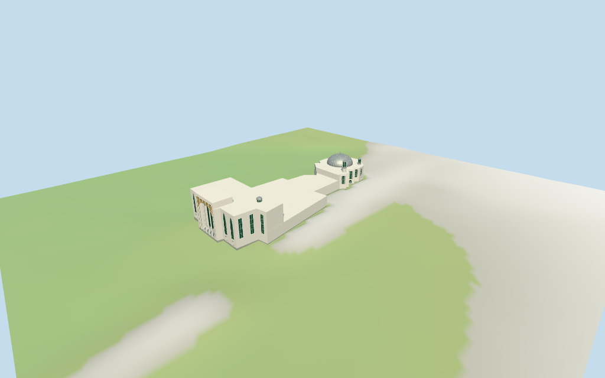

# Baitul Futuh Mosque

Individual Baitul Futuh compound: retained long stepped envelope,contemporary northern street frontage with a pale grand frame,original coarse gold screen around a broad round arch,vertical pale ribs and recessed opaque glazing,arched flanking fields and ground arcades;lower connecting blocks;southern angular prayer hall with tall rectangular glazing,round ground bays,grey stone panels,a silver ribbed dome and two glazed roof turrets;one small cupola over the front wing. Historic inscriptions,exact decorative motifs,garden,fencing,parked cars,neighboring buildings,furnished interiors and engineering are excluded.

## Evidence and reconstruction

Published dimensions and reconstructed details are separated in spec.json. Primary references:

- [Reference](https://commons.wikimedia.org/wiki/File:The_Baitul_Futuh_Mosque_-_geograph.org.uk_-_7842987.jpg)
- [Reference](https://commons.wikimedia.org/wiki/File:Baitul_Futuh.jpg)
- [Reference](https://commons.wikimedia.org/wiki/File:Baitul_Futuh_dome.jpg)

Five existing shared256² raw/coursed/weathered limestone,standing-seam metal and bronze graphs;seven merged roles include local opaque glazing. Metric UVs and linear tints,no embedded images or unique atlas. Coarse gold diamonds and wall fields are original abstractions;no historic artwork or inscriptions are copied.

## Model and axes

6,432 triangles; 19,296 vertices; 7 material groups; 776,160 bytes. Native bounds: -79.887, -2.527, -31.841 to 79.887, 25.718, 31.841. Source hash: `sha256:6c8974284641f6a0a70d8e79dc6f35199d2ae68af0642f3a158224108257dc08`.

{"x":"estimated southern prayer hall","y":"up","z":"estimated western side"}

Standard Protomaps20261014 and Mapzen/USGS viewer extractN0481;datum 24.95192944138828 m. 781 footprint samples span -2.0207217984460044 to 1.4460806653913139 m;floor -0.2818550929968424 m is the median of 168 edge samples plus0.25 m. Footings sample grade;the synthetic review fixture seats the envelope and a3 m margin. Exact threshold,stair,drain and finished ground levels remain unverified.

## Reproduce

Run `node packages/worldgen/scripts/generate-additional-landmarks.mjs --ids=N0481` (or add `--check`). The generator preserves manually edited masters by checking their baseline hashes. Import through the standard authored-model workflow with optimization disabled; then capture all QA cameras, including shared-surface views.

## Pending work

- Retained Q788652 way/33790628 preserves anchor,undirected heading,35 outer vertices,original tags and empty dimensional facts. Current ordinary PMTiles provides a33-vertex compound building and named mosque point sharing id35184405879460. The northern/front block and southern irregular prayer-hall group are retained together. The 2023 frontage picture guides the new facade;older hall/overview pictures guide the silver dome and glazed roof turrets only. Exact roof partitions,turret positions,signed facade bearing and complete current condition remain approximations.
- No retained dimensional facts or current selected-building height tags exist. All levels above the local floor are estimates: rear/connector8.5 m,main hall13.4 m,new front wings22 m,central frontage frame26 m,main dome/finial24.5 m,two hall turrets24.8/20.5 m and front-wing cupola25.8 m. Roof roles,turret positions,arcade/window counts,screen pattern and internal floors are visual estimates,not surveyed dimensions.
- Standard Protomaps20261014 and Mapzen/USGS viewer extractN0481;datum 24.95192944138828 m. 781 footprint samples span -2.0207217984460044 to 1.4460806653913139 m;floor -0.2818550929968424 m is the median of 168 edge samples plus0.25 m. Footings sample grade;the synthetic review fixture seats the envelope and a3 m margin. Exact threshold,stair,drain and finished ground levels remain unverified.
- The2023 street frontage and older hall/dome pictures differ in date. Exact current condition,roof subdivisions,window rhythm,internal layout,thresholds,stairs,structural engineering and physical-device/full-city performance remain unverified.

This bundle follows the medium-fi standard. Medium-fi appearance and geographic fit are reviewed separately. Hash-bound visual acceptance is recorded separately after capture inspection.

## Additional geographic data

©OpenStreetMap contributors;Protomaps;Mapzen/USGS terrain.
