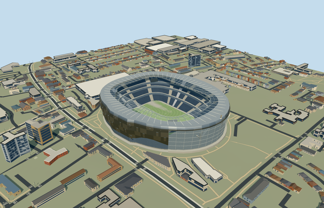

# N0729 — Tottenham Hotspur Stadium

Reviewed2026-10-20 in one author/build/inspect/fix pass.

## Appearance

Inspected 48 final current views: source turntable/details, shared-surface placement, noon/late economy/high, four LODs, original native terrain/context and failed load. Specific silver panel shell/sparse staggered projecting panels/rounded crown and lower west entrance glazing, supported radial roof frame/curved stays/paired inner ring/clear leading strip, continuous single-bank South Stand versus four approximate side/north banks/closed hospitality belts/pale aisles/neutral football field/goals, large south atrium with two visible branching white tree supports/owned floors/pads, four suspended neutral corner displays and a small original roof cockerel/ball silhouette. Replaced an overly open perforated material with an existing opaque brushed-metal graph, widened the south-tree camera and connected roof purlins/rear supports/display hangers during this same construction/inspection pass. Hidden furnished interiors, copied crowd/event/seat graphics and functional pitch-conversion machinery are excluded.

## Shared surfaces and browser budgets

Six existing shared 256px graphs: concrete_plain, metal_painted, metal_stainless_beadblasted, metal_standing_seam, fabric_canvas and window_grid. One untextured PBR glass material with 18% alpha serves the south atrium and clear leading roof strip, preserving actual visible supports without a private texture. No embedded images, new graph or unique atlas. Runtime reads each graph once; seven near draws/one skyline draw. Separate POSITION/NORMAL GPU streams and equal CPU/GPU byte accounting. Neutral daylight/reflected sky/shadows inspected. Glass/reflection/roof optics remain approximations.

| Level | Triangles | Bytes | Draws |
| --- | ---: | ---: | ---: |
| skyline | 828 | 77812 | 1 |
| district | 3374 | 320332 | 7 |
| street | 13516 | 1249200 | 7 |
| closeup | 45228 | 4192220 | 7 |

Four authored levels retain the mapped shell/open field, single South Stand versus multi-bank sides/north, main tree silhouettes and supported roof. Far levels merge rows/framing/panels; small roof sculpture and thin stays appear as the camera approaches. Levels828/3374/13516/45228triangles; initial skyline plus district398144bytes, below3MB phone/6MB laptop asset targets. These are measured asset budgets and repeatable browser captures; physical ordinary-laptop/phone/tablet and dense-city timings remain pending.

## Approximate native placement

RetainedQ55074091 and named native stadiumPOI35184910389087 establish individual parent52776565841254. All four tile fragments of pitch35185009030811 are unioned before measuring105.184966x67.576832m field axis. Own anchor[-0.06622974820272659,51.6042075675057]/heading0/native east-south/internal X[0.06343176603145521,0.9979861777891168]/Z[-0.9979861777891168,0.06343176603145521]. Positive internalX is almost geographic south and holds the single-bank stand/branching atrium. Native72-point outer controls approximately243x207m body;44-point117x81m hole controls lower bowl/runoff, not the larger visible roof aperture. Working roof aperture is1.38times that hole, approximately161x112m, as a photograph-led estimate. Independent north records and historic western street frontage are retained. Fine20degree/2m facing, panel and branch inventories remain approximate. Production helper removes only own stadium52776565841254. All1902 independent resident inputs of1903 originals/all3132 wider independent inputs remain unchanged, including northern development and historic west houses. Original6m grid/roads/zero source water retained. Nine actual PMTiles13/14/15 cases pass, including all four15-level stadium fragments. Lower-zoom merged complexes use bounded clipping. Failure retains1903 originals; every level unload restores ground/water/zero live model geometry. Original standard6m Mapzen grid/roads/water and independent context remain unchanged. Original datum11.890147258790762m defines field/modelY0; boundary samples approximately-.659..1.894m. Own retaining floor extends below minimum original grade, while the bounded opening stays inside every level occupied floor. Tree pads and rear posts meet original sampled contacts; atrium floors are supported within the owned body. Only main stadium parent52776565841254 is replaced using99.5percent whole-feature coverage; lower-zoom merged complexes use bounded area clipping. Do not remove the independent northern development, historic west houses or extend a platform over streets/precinct. Failure/unload preserves or restores original terrain/context.

## Limits

Four structural photographs actually viewed: three ordinary designer-gallery pictures show occupied bowl/south tree atrium/west panel facade; Paul Hudson2020-01-14 South Stand crop confirms its continuous single bank and side transitions/screens. A furnished bar photo is supplementary only and excluded from exterior/bowl scope. No bespoke survey/archive research or copied pixels, event images, lettering or crowd graphics. No qualified native architectural height. Working original datum defines fieldY0; facade4..40m/crown40..46m/roof45.5..46m with1.5m sag/inner lower ring43.3m above field are picture-led. Single South Stand1.4..36m is distinct from four approximate side/north banks1.4..10/14..21/25..28/32..38m and closed inter-tier belts. Two approximate tree forks17m/branch tips31..33m/small roof cockerel about5.7m above roof, four display/panel/cable/row counts and entrance arch remain visual allocations. Photos from the designer and2020 South Stand view define the completed-reference era; the2018 upload directory is not an exposure date. No surveyed dimensions beyond map-derived plan controls, engineering/access certification or exact material optics. Opaque shared glazing and image-free18percent-alpha south/roof panes approximate real reflection/transmission. Hidden furnished bar/interiors and functional retractable-field machinery are excluded. Original standard6m Mapzen grid/roads/water and independent context remain unchanged. Original datum11.890147258790762m defines field/modelY0; boundary samples approximately-.659..1.894m. Own retaining floor extends below minimum original grade, while the bounded opening stays inside every level occupied floor. Tree pads and rear posts meet original sampled contacts; atrium floors are supported within the owned body. Only main stadium parent52776565841254 is replaced using99.5percent whole-feature coverage; lower-zoom merged complexes use bounded area clipping. Do not remove the independent northern development, historic west houses or extend a platform over streets/precinct. Failure/unload preserves or restores original terrain/context.

## Selected checks

Six Khronos files: zero errors/warnings.11132 actual geometry/material/contact checks,48 current inspected views,nine actual native map-level cases. Selected source/import/placement/strict medium-fi/scene validation pass. Sim30 hash436001469e57bc2cfb81c47e0b8bac86e1d89159c116f3c402acfe6ba072ee9b.

Source sha256:13057dbcf8720a6252e644ea79a55d96955c074d47d8e732be4a427a782a38a9

Runtime sha256:49b74b363f721d4e81ea5fba477b4833a145fd6a03aaae9b479937e934658f44

Input sha256:e6182212654311b957b519cdac40238a8e167a6e1a3747adc0fdef0d24026cc7

Rebuild: node packages/worldgen/scripts/generate-additional-landmarks.mjs --ids=N0729; node packages/worldgen/scripts/import-next-1000-models.mjs --ids=N0729; node packages/tooling/scripts/generate-landmark-lods.mjs --ids=N0729 --force.

## Ordinary picture references

https://populous.com/showcases/tottenham-hotspur-football-club — https://populous.com/uploads/2018/01/Tottenham-Hotspur-Stadium_1-1-1200x900-c-center.jpg; Populous gallery; individual frame photographer not separately verified; Copyright retained; viewed only/no copied pixels. Viewed only/no copied pixels.

https://populous.com/showcases/tottenham-hotspur-football-club — https://populous.com/uploads/2018/01/Tottenham-Hotspur-Stadium_14_EDIT-1200x900-c-center.jpg; Populous gallery; individual frame photographer not separately verified; Copyright retained; viewed only/no copied pixels. Viewed only/no copied pixels.

https://populous.com/showcases/tottenham-hotspur-football-club — https://populous.com/uploads/2018/01/Tottenham-Hotspur-Stadium_2-1-1200x900-c-center.jpg; Populous gallery; individual frame photographer not separately verified; Copyright retained; viewed only/no copied pixels. Viewed only/no copied pixels.

https://commons.wikimedia.org/wiki/File:Spurs_stadium_south_stand_cropped.jpg — https://thumb.wikimedia.org/wikipedia/commons/thumb/b/b2/Spurs_stadium_south_stand_cropped.jpg/960px-Spurs_stadium_south_stand_cropped.jpg; Paul Hudson; crop on Commons by Hzh; CC-BY-2.0; https://creativecommons.org/licenses/by/2.0/; viewed only/no copied pixels. Viewed only/no copied pixels.
