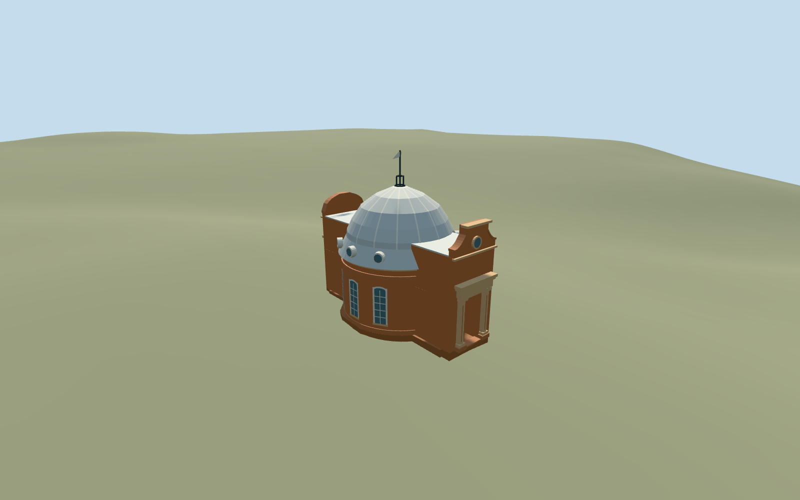

# Altazimuth Pavilion, Royal Observatory Greenwich

Independent Altazimuth Pavilion: circular red-brick body with white sash lights, pale ribbed dome and roof-skirt circular windows, two projecting north/south portals with terracotta columns and entablatures, ornate northern shaped gable and simpler curved southern gable, small cage finial and schematic static comet vane. Preserve every other Observatory member and the separately mapped planetarium. Exterior only; no optics, furnished rooms, operating dome, copied lettering or inscriptions.

## Evidence and reconstruction

Published dimensions and reconstructed details are separated in spec.json. Primary references:

- [Reference](https://commons.wikimedia.org/wiki/File:Altazimuth_Pavilion,_Greenwich_Observatory_-_geograph.org.uk_-_3877791.jpg)
- [Reference](https://commons.wikimedia.org/wiki/File:Altazimuth_Pavilion_At_The_Royal_Observatory_Greenwich_2023_01.jpg)

Independent Altazimuth Pavilion: circular red-brick body with white sash lights, pale ribbed dome and roof-skirt circular windows, two projecting north/south portals with terracotta columns and entablatures, ornate northern shaped gable and simpler curved southern gable, small cage finial and schematic static comet vane. Preserve every other Observatory member and the separately mapped planetarium. Exterior only; no optics, furnished rooms, operating dome, copied lettering or inscriptions.

## Model and axes

5,524 triangles; 14,950 vertices; 5 material groups; 607,916 bytes. Native bounds: -4.045, -0.605, -6.580 to 4.045, 10.780, 6.880. Source hash: `sha256:28a04fb80b78e4b0b703ff2cf4b7a4ec707a9c8f592df813d5c550d76df39035`.

{"x":"east","y":"up","z":"south"}

The geographic proposal uses exact-QID OpenStreetMap evidence. Map-derived orientation and estimated architectural details require real-site visual review; preview eligibility is distinct from geographic/fidelity approval. Map attribution: © OpenStreetMap contributors, ODbL-1.0.

## Reproduce

Run `node packages/worldgen/scripts/generate-additional-landmarks.mjs --ids=N0752_ALTAZIMUTH` (or add `--check`). The generator preserves manually edited masters by checking their baseline hashes. Import through the standard authored-model workflow with optimization disabled; then capture all QA cameras, including shared-surface views.

## Pending work

- Independent Altazimuth Pavilion: circular red-brick body with white sash lights, pale ribbed dome and roof-skirt circular windows, two projecting north/south portals with terracotta columns and entablatures, ornate northern shaped gable and simpler curved southern gable, small cage finial and schematic static comet vane. Preserve every other Observatory member and the separately mapped planetarium. Exterior only; no optics, furnished rooms, operating dome, copied lettering or inscriptions.
- Shared campus Q192988 plus unique way268533441/native35184640622273. The mapped rounded body with two north/south projecting entrances establishes identity and orientation. Own anchor raw[35.8,55], internalX east,Z south, heading0 baked into geometry. Photos from opposite ends establish different north/south gables; the vane bearing and exact ornamental inventories remain approximate. Parent plus its five contained building parts are owned; retain all other campus buildings, including the southern planetarium.
- Parent footprint has no height; five integral building parts carry unqualified3.4/4.5/5/7.8m height hints. Working body radius3.75m/eaves4.3m, roof skirt5.35m, dome crown8.4m, north parapet7.1m/south7.0m and schematic finial/vane10.6m are photo-led estimates. Portal/wall-window/porthole inventories, rib counts, ornamental curves, hidden elevations and vane form/bearing are simplified. Shared raw stone tinted terracotta represents molded clay portal trim; no copied inscriptions or surveyed engineering.
- Existing standard Protomaps20261020/Mapzen201x201/6m Observatory extract reused. Uncovered south entry approach internal[0,6.95], datum47.73069916666667m; floor0.2m above control. Closed footing unions mapped floor with reconstructed circular body and north/south portals. Only the occupied mapped footprint cuts ground; retain original approaches/provider, all independent buildings, roads and water. Approximate native exterior fit reviewed on the original hill; boundary grade -0.46..+0.002m leaves a modest base. Exact historic thresholds, steps and accessibility remain approximate. Ground-cutout coordinates are quantized to1mm to avoid Float32 boundary ambiguity; original elevations and the mapped building-ownership mask remain unchanged.

This bundle follows the medium-fi standard. Medium-fi appearance and geographic fit are reviewed separately. Hash-bound visual acceptance is recorded separately after capture inspection.
