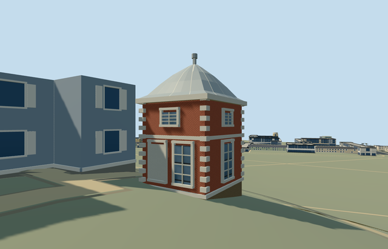

# N0752_EASTPAVILION — Eastern pavilion and Camera Obscura, Royal Observatory Greenwich

Reviewed2026-10-22. **Completed medium-fi exterior with approximate native placement; Observatory collection remains2/7.**

## Built and inspected

Independent eastern Camera Obscura pavilion: mapped rotated square brick block, tall lower windows/blank panel and short upper lights, white quoins/string bands/cornice, rounded lead-colored cap with rib accents and simplified finial. Actual recessed west side door with closed floor and soffit. Reused the three ordinary north/court photographs and standard Observatory extract. Moved the terrain control from the south court to immediately outside the doorway, and moved a review camera out of the neighboring generic building before final capture.

## Shared materials and browser LODs

Four existing256px graphs across the used roles: brick walls/base, stone_limestone_raw white trim, metal_painted lead-colored roof/frames and storefront opaque glass. Five textured draws and one skyline draw. No new graph/private atlas/embedded image. Existing metric material bindings, linear tints, cached graphs and separate POSITION/NORMAL streams retained. Each graph reads once per native textured run; all geometry disposes on unload.

| Level | Triangles | Bytes | Draws |
| --- | ---: | ---: | ---: |
| skyline | 310 | 31316 | 1 |
| district | 1230 | 115692 | 5 |
| street | 1842 | 168320 | 5 |
| closeup | 1842 | 168320 | 5 |

Four authored LODs are within1k/4k/16k/64k triangle caps. Initial skyline+district geometry147008 bytes. Six current GLBs have zero Khronos errors/warnings;48 actual mesh/contact probes and one actual detailed level15 map case pass. No matching generalized13/14 pavilion record. Inspected48 current source/shared/medium-fi/native frames including failure and all LOD unloads. Physical device/dense-city timings remain pending.

## Geographic placement

Approximate native exterior fit accepted. Shared Q192988 with independent way268533443/native35184640622275 and its own anchor[-0.0017826472073499606,51.478076776441995]. Heading0, mapped east-northeast/south-southeast axes baked into native coordinates. Provider immediately west of the door at internal[-3.2,0] fixes datum45.70766003019248m, floor0.2m above it. Boundary grade -0.91..+0.43m leaves modest uphill plinth burial/downhill brick base on the original hill. Only its own occupied footprint cuts ground/replaces a building, preserving all1301 independent resident/1838 wider buildings, including Flamsteed House and all other Observatory members. Original201x201/6m grid, roads and9681.379312m² water retained. Failure keeps1302 originals; all four LOD unloads restore ground/water with zero live geometry. Exact historic terrace/threshold levels, step clearance and accessibility remain approximate.

## Fidelity and limits

Photo-led medium-fi exterior: no mapped height, working5.5m brick wall,5.65m cornice,8.1m cap and8.8m finial. Window/stone inventory, lead profile, blocked lower panel, simplified finial and hidden east/west elevations are proxies. The west doorway location is reconstructed from the court view. No camera optics, furnished room, operational equipment, copied inscriptions or signage. The existing general brick graph supplies a consistent shared surface rather than an exact historic bond. This independent member does not complete the Observatory candidate.

## Targeted checks

Selected generation/import/placement, strict medium-fi, scene/sim30 and recipe lint pass. Sim30 sha256:3ee413e83aebb9c8eb392cab5d1938928a6848c8f4831433797758c462ac3313. Collection tests11+4 passed earlier in this Observatory round. Pins: [qa.json](qa.json); [source controls](map-frame.json).

## Viewed references

- https://commons.wikimedia.org/wiki/File:Flamsteed_House_Greenwich_2023_01.jpg — Julian Herzog; 2023-11-17; CC-BY-4.0. Viewed only; no copied pixels.

- https://commons.wikimedia.org/wiki/File:Flamsteed_House_-_Royal_Observatory_Greenwich_(8131031429).jpg — Elliott Brown; 2012-10-14; CC-BY-2.0. Viewed only; no copied pixels.

- https://commons.wikimedia.org/wiki/File:Flamsteed_House_Royal_Observatory_from_National_Maritime_Museum_colonnade_Greenwich_London_England_02.jpg — Acabashi; 2025-11-30; CC-BY-SA-4.0. Viewed only; no copied pixels.

- https://www.openstreetmap.org/way/268533443 — independent pavilion footprint, ©OpenStreetMap contributors ODbL-1.0. Standard PMTiles/Mapzen, no bespoke terrain research.

## Completion checklist

- [x] Source rebuild, import, four authored LODs and existing shared materials.
- [x] Current actual source/shared/native views, geometry and lifecycle checks.
- [x] Independent identity, map orientation and approximate hillside placement.
- [ ] Five other required Observatory members.
