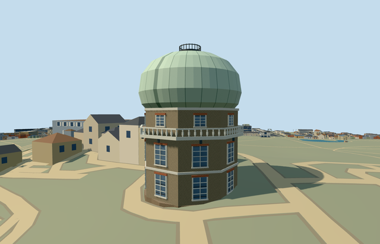

# N0752_EQUATORIAL — Great Equatorial Building, Royal Observatory Greenwich

Reviewed 2026-10-22. **Completed medium-fi exterior with approximate native placement; Observatory collection remains4/7.**

## Built and inspected

Independent Great Equatorial Building: stock-brick octagonal three-storey base, red flat sash heads, pale string/cornice bands, projecting white gallery with open guard band and dark brackets, pale-green onion dome with curved seams/static closed shutter cue and small fenced crown. A true west entry recess has a closed floor and soffit. Two ordinary photos and the existing standard Observatory extract guided one continuous author/inspect pass. Neighboring Meridian ranges and other campus buildings remain independent context.

## Shared materials and browser LODs

Four existing 256 px shared graphs: brick walls/plinth/red heads, stone_limestone_raw pale trim, metal_painted green dome/white painted gallery/frames/dark crown, storefront opaque glass. Painted metal is a documented shared substitute for painted timber gallery components. Five textured draws and one skyline draw. No new graph, private atlas or embedded image. Facade tangent projection, linear tints and separate POSITION/NORMAL streams retained. Each graph reads once per native textured run; unload disposes all model geometry.

| Level | Triangles | Bytes | Draws |
| --- | ---: | ---: | ---: |
| skyline | 916 | 77308 | 1 |
| district | 3124 | 276332 | 5 |
| street | 5352 | 478460 | 5 |
| closeup | 6664 | 604416 | 5 |

Four authored LODs 916 / 3,124 / 5,352 / 6,664 triangles, within 1k / 4k / 16k / 64k caps. Initial skyline+district geometry 353,640 bytes; shared material bakes are separately cached. Six GLBs have zero Khronos errors/warnings; 60 actual geometry/contact probes and two actual PMTiles 14/15 cases pass, including the one detailed owned record. No matching level 13 record. Inspected 48 current portable/shared/medium-fi/native frames, including all LODs, failed loading, Economy/High and noon/late light. Physical device/dense-city timing measurements remain pending.

## Geographic placement

Approximate native exterior fit accepted. Shared Q192988 plus unique way268533517/native35184640622349, with own map anchor[-0.001143689958793065,51.477716552013064] and east/south axes baked into heading 0. Facade and static slit bearing remain photo-led with 15 degree uncertainty. Uncovered west approach[-6.2,-1.5] sets datum45.85362333333333m and floor0.2m above control. Boundary grades -0.53..+0.86m leave a modest downhill base/slight uphill burial. Closed footing unions mapped rounded footprint and octagonal body. Only its occupied map footprint cuts ground/replaces a building; retain all 1,301 independent resident / 1,838 wider buildings including the earlier three Observatory assets, contiguous Meridian range and southwest annex. Original 201x201/6m grid, roads and 9,681.379312 m² water retained. Failure keeps all 1,302 resident originals; all four LOD unloads restore ground/water and zero live model geometry. Exact historic terraces/entry/gallery connections and accessibility remain approximate.

## Fidelity and limits

Photo-led medium-fi exterior. The unqualified mapped 11m height does not identify base/dome breakdown. Working body 9.6m, gallery deck 6.5m / rail 7.6m, onion bulge radius 6.05m / crown 16.2m and fenced top 17m are reconstructed. Window/arch/bracket inventories, closed slit bearing, hidden west doorway/rear and dome profiles are simplified. Painted metal substitutes for gallery timber; shared brick is a consistent surface rather than an exact historic bond. No telescope optics, furnished rooms, working dome/shutter, copied signs or inscriptions, surveyed engineering or certified walking access. This fourth member does not complete the seven-building Observatory candidate.

## Targeted checks

Selected generation/import/placement, strict medium-fi, scene/sim30 and recipe lint pass. Sim30 sha256:35c4ad942d7dabfb774b8fba06058ea0ac796bb6408c1a334132a58b4aaeb649. Collection tests11+4 passed earlier in this Observatory round. Pins: [qa.json](qa.json); [source controls](map-frame.json).

## Viewed references

- https://commons.wikimedia.org/wiki/File:Great_Equatorial_Building,_Greenwich,_London.jpg — Robert von Oliva (naruciakk); 2020-02-11; CC0-1.0. Viewed only; no copied pixels.

- https://commons.wikimedia.org/wiki/File:Royal_Observatory_Greenwich_-_28-Inch_Telescope_Dome_and_Meridian_Building_(8128784575).jpg — Elliott Brown; 2012-10-14; CC-BY-2.0. Viewed only; no copied pixels.

- https://www.openstreetmap.org/way/268533517 — independent Equatorial footprint, ©OpenStreetMap contributors ODbL-1.0. Standard PMTiles/Mapzen, no bespoke terrain research.

## Completion checklist

- [x] Source rebuild, import, four authored LODs and existing shared materials.
- [x] Current actual source/shared/native views, geometry and lifecycle checks.
- [x] Independent identity, map orientation and approximate hillside placement.
- [ ] Three other required Observatory members.
