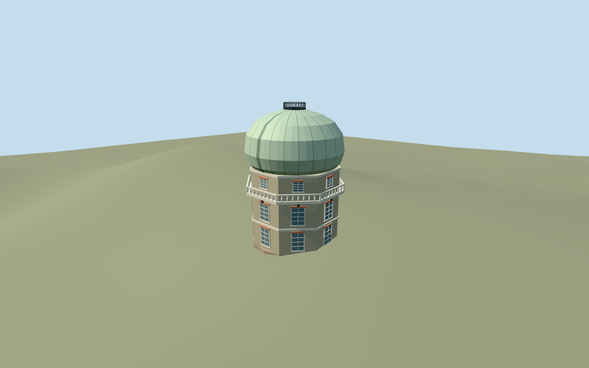

# Great Equatorial Building, Royal Observatory Greenwich

Independent Great Equatorial Building: octagonal stock-brick three-storey base, pale string/cornice bands, sash lights/red flat arches, bracketed white projecting gallery, broad pale-green onion dome with curved seams/closed shutter cue and small fenced crown. Keep the Meridian range, all earlier Observatory assets and every separate building as context. No telescope optics, furnished rooms, operating dome or copied signs.

## Evidence and reconstruction

Published dimensions and reconstructed details are separated in spec.json. Primary references:

- [Reference](https://commons.wikimedia.org/wiki/File:Great_Equatorial_Building,_Greenwich,_London.jpg)
- [Reference](https://commons.wikimedia.org/wiki/File:Royal_Observatory_Greenwich_-_28-Inch_Telescope_Dome_and_Meridian_Building_(8128784575).jpg)

Independent Great Equatorial Building: octagonal stock-brick three-storey base, pale string/cornice bands, sash lights/red flat arches, bracketed white projecting gallery, broad pale-green onion dome with curved seams/closed shutter cue and small fenced crown. Keep the Meridian range, all earlier Observatory assets and every separate building as context. No telescope optics, furnished rooms, operating dome or copied signs.

## Model and axes

6,664 triangles; 18,922 vertices; 5 material groups; 764,596 bytes. Native bounds: -6.075, -0.681, -6.075 to 6.075, 17.180, 6.080. Source hash: `sha256:3735c90c74279b1da12cf50aacc5078acb48dd96b305454c227ec39d9bdc9800`.

{"x":"east","y":"up","z":"south"}

The geographic proposal uses exact-QID OpenStreetMap evidence. Map-derived orientation and estimated architectural details require real-site visual review; preview eligibility is distinct from geographic/fidelity approval. Map attribution: © OpenStreetMap contributors, ODbL-1.0.

## Reproduce

Run `node packages/worldgen/scripts/generate-additional-landmarks.mjs --ids=N0752_EQUATORIAL` (or add `--check`). The generator preserves manually edited masters by checking their baseline hashes. Import through the standard authored-model workflow with optimization disabled; then capture all QA cameras, including shared-surface views.

## Pending work

- Independent Great Equatorial Building: octagonal stock-brick three-storey base, pale string/cornice bands, sash lights/red flat arches, bracketed white projecting gallery, broad pale-green onion dome with curved seams/closed shutter cue and small fenced crown. Keep the Meridian range, all earlier Observatory assets and every separate building as context. No telescope optics, furnished rooms, operating dome or copied signs.
- Shared campus Q192988 plus unique way268533517/native35184640622349, declared independent Great Equatorial Building. Standard map gives a16-vertex rounded footprint and11m height; photos establish the octagonal base and larger onion dome. Own anchor raw[17,13], internalX east,Z south, heading0 baked into native coordinates. Facade/closed slit bearing is a photo-led approximation with15degree uncertainty. Only this footprint may be replaced; retain contiguous Meridian ways268533454/446/457/459.
- Mapped11m height is an unqualified control that does not identify dome/base breakdown. Working octagon circumradius5.65m, brick body9.6m, gallery deck6.5m/rail7.6m, onion base9.6m/bulge radius6.05m/crown16.2m and fenced top17m are photo-led estimates, not a surveyed overall height. Dome seams, closed slit bearing, gallery extent, sash/arch counts and concealed rear/door are approximations. Pale painted metal is an explicit shared substitute for painted wood gallery rails. No operational optics/interior, copied signage or certified access.
- Existing standard Protomaps20261020/Mapzen201x201/6m Observatory extract reused. Uncovered west approach internal[-6.2,-1.5], datum45.85362333333333m; floor0.2m above control. Closed footing unions the mapped rounded footprint with the octagonal body, covering the original floor cutout. Only the owned mapped footprint cuts ground; retain neighboring buildings, approach/provider, roads and water. Native exterior fit inspected and accepted with a modest downhill plinth and slight uphill burial; exact historic terraces/entry/raised gallery connection and accessibility remain approximate.

This bundle follows the medium-fi standard. Medium-fi appearance and geographic fit are reviewed separately. Hash-bound visual acceptance is recorded separately after capture inspection.
