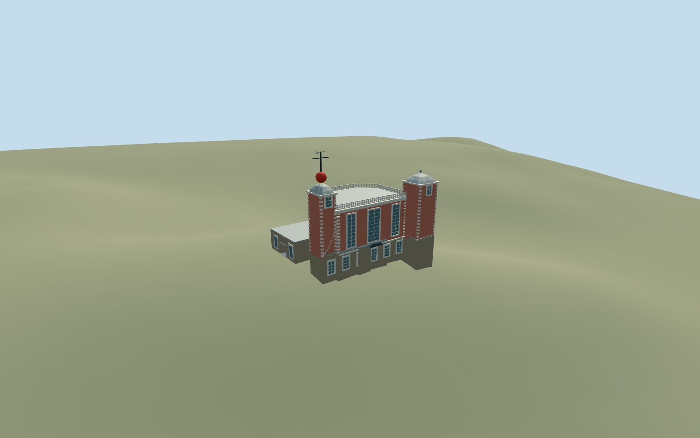

# Flamsteed House, Royal Observatory Greenwich

Flamsteed House only: the mapped connected historic house, tall canted Octagon Room, north corner turrets with domed caps, red time ball and signal mast, white stone quoins/cornices and roof balustrade, low attached museum range and its recessed east entry. The detached eastern pavilion, Meridian Building and Great Equatorial dome, Altazimuth Pavilion, South Building and Peter Harrison Planetarium are independent required members, not parts of this GLB. Gardens, terrace fences, sculptures and incidental sheds remain context.

## Evidence and reconstruction

Published dimensions and reconstructed details are separated in spec.json. Primary references:

- [Reference](https://commons.wikimedia.org/wiki/File:Flamsteed_House_Greenwich_2023_01.jpg)
- [Reference](https://commons.wikimedia.org/wiki/File:Flamsteed_House_-_Royal_Observatory_Greenwich_(8131031429).jpg)
- [Reference](https://commons.wikimedia.org/wiki/File:Flamsteed_House_Royal_Observatory_from_National_Maritime_Museum_colonnade_Greenwich_London_England_02.jpg)

Flamsteed House only: the mapped connected historic house, tall canted Octagon Room, north corner turrets with domed caps, red time ball and signal mast, white stone quoins/cornices and roof balustrade, low attached museum range and its recessed east entry. The detached eastern pavilion, Meridian Building and Great Equatorial dome, Altazimuth Pavilion, South Building and Peter Harrison Planetarium are independent required members, not parts of this GLB. Gardens, terrace fences, sculptures and incidental sheds remain context.

## Model and axes

9,428 triangles; 23,220 vertices; 5 material groups; 952,488 bytes. Native bounds: -15.504, -2.617, -12.402 to 14.117, 22.270, 12.089. Source hash: `sha256:0705ebee85144a42187ccecbd1a349bfa63ae130ca6564c9158084be786c3ef5`.

{"x":"east","y":"up","z":"south"}

The geographic proposal uses exact-QID OpenStreetMap evidence. Map-derived orientation and estimated architectural details require real-site visual review; preview eligibility is distinct from geographic/fidelity approval. Map attribution: © OpenStreetMap contributors, ODbL-1.0.

## Reproduce

Run `node packages/worldgen/scripts/generate-additional-landmarks.mjs --ids=N0752_FLAMSTEED` (or add `--check`). The generator preserves manually edited masters by checking their baseline hashes. Import through the standard authored-model workflow with optimization disabled; then capture all QA cameras, including shared-surface views.

## Pending work

- Flamsteed House only: the mapped connected historic house, tall canted Octagon Room, north corner turrets with domed caps, red time ball and signal mast, white stone quoins/cornices and roof balustrade, low attached museum range and its recessed east entry. The detached eastern pavilion, Meridian Building and Great Equatorial dome, Altazimuth Pavilion, South Building and Peter Harrison Planetarium are independent required members, not parts of this GLB. Gardens, terrace fences, sculptures and incidental sheds remain context.
- Shared Royal Observatory Q192988 and unique way268533444/native35184640622276 identify this independent building. The mapped Time Ball point node9362574562/native17601548618978 lies on its northeast turret. Use the building map anchor, not the campus POI. InternalX follows the mapped east-northeast wall axis; internalZ south-southeast. Heading0, orientation baked into native east/south geometry. Retain every independent Observatory building and nearby pavilion.
- No height on the main footprint. Working low range4.1m, tall room11.8m, turrets15m, domes16.6m and signal mast/time-ball top22m are ordinary-photo estimates. Tall window proportions, domed profiles, quoins, roof balusters and low southern/hidden extensions are reconstructed. Static schematic vane/ball and simplified closed glazing; no furnished telescope rooms, operational clock/ball, copied inscriptions or signage.
- Original standard Protomaps20261020/Mapzen201x201 at6m, no custom terrain or broad flattening. Provider in uncovered eastern court at internal[16,1], absolute datum 46.95540996716767m; main floor0.25m above control. Brick closed substructure follows the original minimum boundary grade; only occupied house footprint cuts terrain. Uncovered terrace, provider, roads/water and every other building remain original. Approximate exterior native fit reviewed on2026-10-22 from the north, court and southern range. Original boundary grades span -2.47 to+0.18m relative to the eastern court; the brick substructure seats the house on the hill without flattening the surrounding terrace. Exact historic retaining walls, threshold/accessibility and pedestrian circulation remain approximate.

This bundle follows the medium-fi standard. Medium-fi appearance and geographic fit are reviewed separately. Hash-bound visual acceptance is recorded separately after capture inspection.
