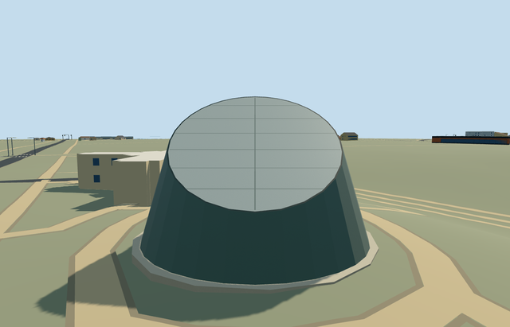
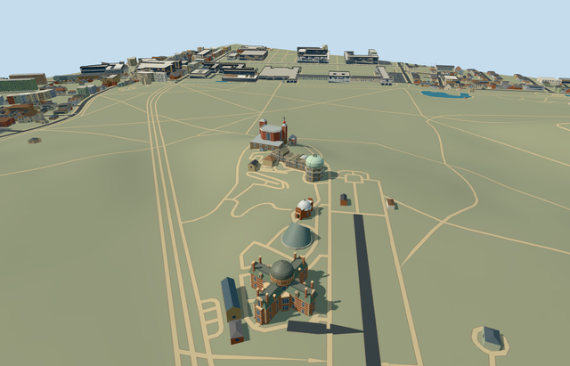

# N0752_PLANETARIUM — Peter Harrison Planetarium, Royal Observatory Greenwich

Reviewed 2026-10-22. **Completed medium-fi exterior with approximate native placement; Observatory collection 7/7.**

## Built and inspected

Exposed Peter Harrison Planetarium: low circular mapped footing, oblique bronze cone, north-facing inclined reflective metal cap, continuous dark perimeter rim and restrained broad panel divisions. North shell generatrix is near vertical, north cap rim lower than south. Closed footing/shell/cap; no fabricated exterior door. Two ordinary pictures and the existing map guided one author/inspect/fix pass. Corrected reversed footing faces and trimmed the central cap joint inside the rim before final captures.

## Shared materials and browser LODs

Two existing256px shared graphs: metal_painted tinted patinated bronze on the shell, pale reflective metal on the cap and dark metal on its rim/joints; stone_limestone_raw on the modest mapped footing. Painted metal is an explicit shared substitute for bronze/polished cap. Four textured draws/one skyline draw. No new graph/private atlas/embedded image. Linear tints and separate POSITION/NORMAL streams; equal CPU/GPU accounting. Each native textured run reads each graph once; all LOD unloads release geometry.

| Level | Triangles | Bytes | Draws |
| --- | ---: | ---: | ---: |
| skyline | 112 | 11128 | 1 |
| district | 174 | 19316 | 4 |
| street | 222 | 23656 | 4 |
| closeup | 270 | 27980 | 4 |

Four authored LODs 112 / 174 / 222 / 270 triangles, within 1k / 4k / 16k / 64k caps. Initial skyline+district geometry 30444 bytes; shared material bakes cached separately. Six GLBs have zero Khronos errors/warnings; 90 actual geometry/contact probes and two actual PMTiles 14/15 cases pass, including one detailed owned record. No matching level 13 record. Inspected 48 current portable/shared/medium-fi/native frames, all LODs, failed loading, Economy/High and noon/late light. Physical device/dense-city timings remain pending.

## Geographic placement

Approximate native exterior fit reviewed. Shared Q192988 plus unique way268533449/native35184640622281; parent has no contained mapped parts. Anchor[-0.000744161385767647,51.47714612180765], heading0, X east/Z south. Uncovered north control[0,-9.5], datum47.67441333333333m, footing0.2m above provider. Original boundary grades -0.714..+0.105m leave a modest low-side base. Occupied parent footprint only cuts ground/replaces its mapped record; all1,301 resident/1,838 wider independent buildings retained, including South Building, Altazimuth and southwest annex. Original201x201/6m hill, roads and9,681.379312m² water retained. Ground-only mask quantized1mm; mapped ownership/elevations unchanged. Failure keeps1,302 originals; each LOD unload restores ground/water and zero live geometry. Exact paving, underground theater and entrance levels remain unverified.

## Combined Observatory campus

Actually inspected all eight current combined-campus frames, all four LODs plus failed loading. Seven independent placements coexist with expected terrain heights and anchors, despite shared Q192988. Own18 mapped records only;1,284 resident and1,821 wider independent buildings retained. Five shared graphs read once per textured run. Original hill/roads/water retained; unload restores ground/water and zero live model geometry. Controlled native fixture forces the selected LOD; physical device timings and underground access are outside this check.

## Fidelity and limits

Photo-led medium-fi exterior. No mapped heights; working7.4m cone radius, about3.3m north rim/9.6m high south rim and38.5degree top incline are reconstructed, not surveyed engineering. Profile, panel inventory, hidden surface and patina simplified using shared materials. Underground theater/entry passages, furnished interior, projector, cafe, temporary barriers and signs omitted. No copied pixels or inscriptions. All seven declared Observatory exterior members are now authored and inspected; this is not a reconstruction of every underground or historic campus feature. Physical device/dense-city timings and exact walking access remain pending.

## Targeted checks

Selected generation/import/placement, strict medium-fi, scene/sim30 and recipe lint pass. Sim30 sha256:1fc816f817e1a2138250bf2022b08834d41166c2f63a2e0fb444be370ecfd2f1. Collection tests11+4 passed earlier in this Observatory round. Pins: [qa.json](qa.json); [source controls](map-frame.json).

## Viewed references

- https://commons.wikimedia.org/wiki/File:The_Peter_Harrison_Planetarium,_Greenwich_Park.jpg — Ethan Doyle White; 2020-05-25; CC-BY-SA-4.0. Viewed only; no copied pixels.

- https://commons.wikimedia.org/wiki/File:Peter_Harrison_Planetarium.jpg — Mike Peel (www.mikepeel.net); 2009-07-11; CC-BY-SA-4.0. Viewed only; no copied pixels.

- https://www.openstreetmap.org/way/268533449 — independent rounded planetarium footprint, ©OpenStreetMap contributors ODbL-1.0. Standard PMTiles/Mapzen, no bespoke terrain research.

## Completion checklist

- [x] Source rebuild, import, four authored LODs and existing shared materials.
- [x] Current actual source/shared/native views, geometry and lifecycle checks.
- [x] Independent identity, map orientation and approximate hillside placement.
- [x] All seven declared Observatory members authored and jointly inspected.
