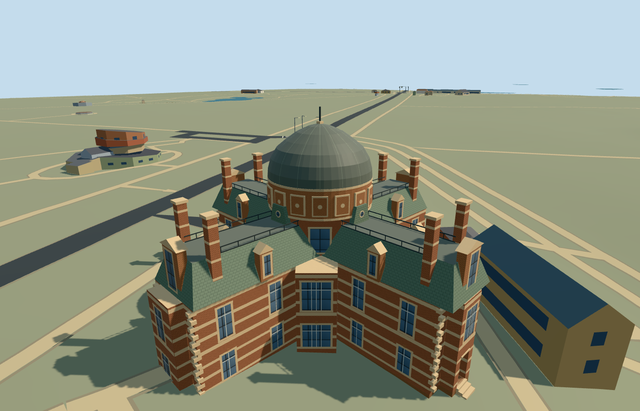

# N0752_SOUTH — South Building, Royal Observatory Greenwich

Reviewed 2026-10-22. **Completed medium-fi exterior with approximate native placement; Observatory collection remains 6/7.**

## Built and inspected

Independent South Building: full mapped cruciform two-storey body, banded brick and terracotta, canted central bays, green-gray mansards, pedimented dormers/end pavilions, eight tall chimneys, iron roof cresting, raised drum with abstract relief panels and roof oculi, and a broad dark copper dome/simple finial. Reconstructed lower west service recess has a closed floor/soffit and three actual0.2m treads. Four ordinary photos plus the existing map/terrain extract guided one continuous author/inspect/fix pass. Seated corner quoins on the actual footprint, widened canted windows, added drum/oculus identity features and moved cameras clear of independent utility buildings. Closed the mansard overhang soffits and dome rim after inspecting the close views. No copied figures, inscriptions or signs.

## Shared materials and browser LODs

Five existing 256 px shared graphs: brick walls/base, stone_limestone_raw tinted terracotta for cream bands/pilasters/quoins/abstract relief, green-gray tinted slate mansards, metal_painted copper dome/frames/iron cresting, storefront opaque glass. Raw stone is a documented shared substitute for molded terracotta. Six textured draws/one skyline draw. No new graph/private atlas/embedded image. Tangent-projected surfaces, linear tints, cached graphs and separate POSITION/NORMAL streams retained. Every native textured run reads each graph once; all LOD unloads dispose the model geometry.

| Level | Triangles | Bytes | Draws |
| --- | ---: | ---: | ---: |
| skyline | 876 | 76748 | 1 |
| district | 3434 | 268744 | 6 |
| street | 6888 | 580460 | 6 |
| closeup | 7848 | 658724 | 6 |

Four authored LODs 876 / 3434 / 6888 / 7848 triangles, within 1k / 4k / 16k / 64k caps. Initial skyline+district geometry 345492 bytes; shared material bakes cached separately. Six GLBs have zero Khronos errors/warnings; 125 actual geometry/contact probes and two actual PMTiles 14/15 cases pass, including one detailed owned record. No matching level 13 record. Inspected 48 current portable/shared/medium-fi/native frames, all LODs, failed loading, Economy/High and noon/late light. Physical device/dense-city timings remain pending.

## Geographic placement

Approximate native exterior fit accepted. Shared Q192988 plus unique way268533442/native35184640622274, no contained map parts. Own anchor[-0.000530694855775727,51.47684518618747], heading0 with east/south axes baked into the mapped cross. Uncovered west control[-16.8,0], datum44.36029666666667m; working lower floor0.6m above it with three0.2m treads. Original boundary grades -0.257..+1.332m leave a modest lower-side base/slight uphill burial. Only this parent cuts ground/replaces a mapped building; preserve all 1,301 independent resident / 1,838 wider buildings, including the earlier five Observatory models, separate planetarium and southwest annex. Original 201x201/6m hill, roads and 9,681.379312 m² water retained. Ground-only mask quantized to1mm; source elevations and mapped ownership unchanged. Failure retains all 1,302 resident originals; every LOD unload restores ground/water with zero live geometry. Controlled native test manually selects this asset with procedural neighbors. Exact historic retaining terraces, first-floor principal entry/access and thresholds remain approximate.

## Fidelity and limits

Photo-led medium-fi exterior; no mapped heights. Working wall7.8m/mansard10.7m, end pavilion12.4m/chimneys14m, upper core11.3m/drum14m/dome18.8m and finial20.3m are reconstructed. Facade, dormer, stack, quoin and band inventories, hidden north/south elevations, roof junctions and dome/relief profiles are simplified. Abstract relief replaces sculpture portraits, crests and inscriptions. The historic principal eastern entrance is at first-floor level; exact access is not reconstructed. Lower west service-door bearing and three treads are approximate working proxies. Skyline flattens the small service recess; all other levels retain the true recess/soffit. No furnished galleries, operating telescopes, copied signs, sculptural likenesses, surveyed engineering or certified walking access. This sixth member does not complete the Observatory candidate.

## Targeted checks

Selected generation/import/placement, strict medium-fi, scene/sim30 and recipe lint pass. Sim30 sha256:c10fe12a593844fb5e82ef9c5d872061a8892c9012d6dce5e33cfdc6182057be. Collection tests11+4 passed earlier in this Observatory round. Pins: [qa.json](qa.json); [source controls](map-frame.json).

## Viewed references

- https://commons.wikimedia.org/wiki/File:Royal_Observatory,_South_Building,_Greenwich,_London,_UK,_2015.jpg — Benjamín Núñez González; 2015-01-06; CC-BY-SA-4.0. Viewed only; no copied pixels.

- https://commons.wikimedia.org/wiki/File:Eastern_Side_of_the_South_Building_at_the_Royal_Observatory,_Greenwich.jpg — Ethan Doyle White; 2020-05-25; CC-BY-SA-4.0. Viewed only; no copied pixels.

- https://commons.wikimedia.org/wiki/File:Royal_Observatory_Greenwich_-_Astronomy_Centre_(8142716995).jpg — Elliott Brown; 2012-10-14; CC-BY-2.0. Viewed only; no copied pixels.

- https://commons.wikimedia.org/wiki/File:Western_Side_of_the_South_Building_at_the_Royal_Observatory,_Greenwich.jpg — Ethan Doyle White; 2020-05-25; CC-BY-SA-4.0. Viewed only; no copied pixels.

- https://www.openstreetmap.org/way/268533442 — independent cruciform South Building footprint, ©OpenStreetMap contributors ODbL-1.0. Standard PMTiles/Mapzen, no bespoke terrain research.

## Completion checklist

- [x] Source rebuild, import, four authored LODs and existing shared materials.
- [x] Current actual source/shared/native views, geometry and lifecycle checks.
- [x] Independent identity, map orientation and approximate hillside placement.
- [ ] One other required Observatory members.
