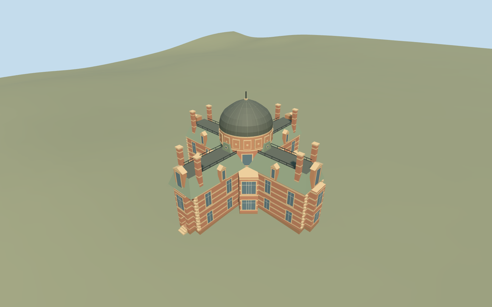

# South Building, Royal Observatory Greenwich

Independent South Building: full mapped cruciform two-storey body, banded red brick and pale terracotta, canted central bays, green-gray mansard roofs with pedimented dormers, four end pavilions and paired tall chimneys, raised decorated drum and broad dark copper dome. Reconstruct a lower west service entrance recess/soffit and three approach treads; entrance bearing and thresholds are approximate. Preserve the independent planetarium, Altazimuth Pavilion and all other campus buildings. Exterior only: no furnished galleries, working instruments, copied inscriptions, sculpture portraits or signs.

## Evidence and reconstruction

Published dimensions and reconstructed details are separated in spec.json. Primary references:

- [Reference](https://commons.wikimedia.org/wiki/File:Royal_Observatory,_South_Building,_Greenwich,_London,_UK,_2015.jpg)
- [Reference](https://commons.wikimedia.org/wiki/File:Eastern_Side_of_the_South_Building_at_the_Royal_Observatory,_Greenwich.jpg)
- [Reference](https://commons.wikimedia.org/wiki/File:Royal_Observatory_Greenwich_-_Astronomy_Centre_(8142716995).jpg)
- [Reference](https://commons.wikimedia.org/wiki/File:Western_Side_of_the_South_Building_at_the_Royal_Observatory,_Greenwich.jpg)

Independent South Building: full mapped cruciform two-storey body, banded red brick and pale terracotta, canted central bays, green-gray mansard roofs with pedimented dormers, four end pavilions and paired tall chimneys, raised decorated drum and broad dark copper dome. Reconstruct a lower west service entrance recess/soffit and three approach treads; entrance bearing and thresholds are approximate. Preserve the independent planetarium, Altazimuth Pavilion and all other campus buildings. Exterior only: no furnished galleries, working instruments, copied inscriptions, sculpture portraits or signs.

## Model and axes

7,848 triangles; 19,504 vertices; 6 material groups; 800,196 bytes. Native bounds: -16.525, -0.407, -16.356 to 15.508, 20.880, 16.203. Source hash: `sha256:c2811cc698eb8c4554286bf48792110c7fb43ebfc4fe45c1b82cd38d2d2b034e`.

{"x":"east","y":"up","z":"south"}

The geographic proposal uses exact-QID OpenStreetMap evidence. Map-derived orientation and estimated architectural details require real-site visual review; preview eligibility is distinct from geographic/fidelity approval. Map attribution: © OpenStreetMap contributors, ODbL-1.0.

## Reproduce

Run `node packages/worldgen/scripts/generate-additional-landmarks.mjs --ids=N0752_SOUTH` (or add `--check`). The generator preserves manually edited masters by checking their baseline hashes. Import through the standard authored-model workflow with optimization disabled; then capture all QA cameras, including shared-surface views.

## Pending work

- Independent South Building: full mapped cruciform two-storey body, banded red brick and pale terracotta, canted central bays, green-gray mansard roofs with pedimented dormers, four end pavilions and paired tall chimneys, raised decorated drum and broad dark copper dome. Reconstruct a lower west service entrance recess/soffit and three approach treads; entrance bearing and thresholds are approximate. Preserve the independent planetarium, Altazimuth Pavilion and all other campus buildings. Exterior only: no furnished galleries, working instruments, copied inscriptions, sculpture portraits or signs.
- Shared campus Q192988 plus unique way268533442/native35184640622274, the mapped cross-shaped South Building. Parent has no mapped height and no contained building_part records in this extract. Own anchor raw[59.5,110], X east/Z south, heading0 baked into the mapped footprint. East/west photo labels and cross arms guide orientation. Four repeated roof/stack treatments and hidden north/south elevations are reconstructed; lower west service-door assignment is approximate. Only this parent footprint is owned; the separately mapped planetarium and every other campus building remain independent.
- No mapped height. Working wall7.8m/mansard10.7m, end pavilions12.4m/chimneys14m, upper core11.3m/drum14m/dome18.8m and simple finial20.3m are picture-led estimates. Banded facade/window/pilaster/dormer inventories, hidden roof junctions, end repetition and dome profile are simplified. Shared stone graph tinted terracotta substitutes for molded ornament; slate is tinted green-gray. The historic principal eastern entrance is at first-floor level; exact hillside access is unverified and the lower west door is a reconstructed service-entry proxy, not a surveyed principal entrance.
- Existing standard Protomaps20261020/Mapzen201x201/6m Observatory extract reused. Uncovered western approach internal[-16.8,0] fixes datum44.36029666666667m, working lower floor0.6m above it with three0.2m treads. Original hill slopes across the cross-shaped footprint; closed foundation follows its minimum boundary grade. Only the occupied parent footprint cuts ground. Approximate native exterior fit reviewed on the original hill; boundary grades -0.257..+1.332m leave a modest lower-side base and slight uphill burial. Exact historic retaining terraces, principal first-floor access and thresholds remain approximate. No bespoke terrain acquisition or broad flattening.

This bundle follows the medium-fi standard. Medium-fi appearance and geographic fit are reviewed separately. Hash-bound visual acceptance is recorded separately after capture inspection.
