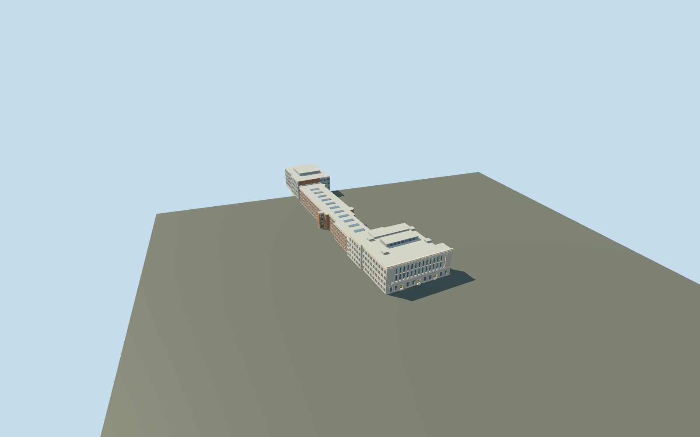

# Science Museum

Science Museum connected exterior on its actual long mapped footprint: giant Ionic-columned pale stone Exhibition Road frontage and three real recessed lower entrances, stepped cornice/parapet, repeated tall paired-level glazing, rear clerestory/flat roof blocks, long red-brick gallery range with restrained roof lanterns and western modern grey/glazed block. Source silhouette follows the complete mapped east-to-west museum, not only its street facade. Adjacent north mapped buildings, Natural History Museum, separate links and Imperial College remain independent. No copied lettering, temporary banners, furnished galleries, vehicles/art collections or neighboring green barrel-roof building.

## Evidence and reconstruction

Published dimensions and reconstructed details are separated in spec.json. Primary references:

- [Reference](https://commons.wikimedia.org/wiki/File:Science_Museum,_Exhibition_Road_(cropped).jpg)
- [Reference](https://commons.wikimedia.org/wiki/File:Kensington_Museums_aerial_2011_a.jpg)

Science Museum connected exterior on its actual long mapped footprint: giant Ionic-columned pale stone Exhibition Road frontage and three real recessed lower entrances, stepped cornice/parapet, repeated tall paired-level glazing, rear clerestory/flat roof blocks, long red-brick gallery range with restrained roof lanterns and western modern grey/glazed block. Source silhouette follows the complete mapped east-to-west museum, not only its street facade. Adjacent north mapped buildings, Natural History Museum, separate links and Imperial College remain independent. No copied lettering, temporary banners, furnished galleries, vehicles/art collections or neighboring green barrel-roof building.

## Model and axes

39,285 triangles; 117,735 vertices; 7 material groups; 4,714,192 bytes. Native bounds: -287.236, -3.079, -34.413 to 4.517, 29.900, 65.107. Source hash: `sha256:2d7a00b83ce2a02d91e116feac8f0e263e8420065ed7022a5d7c009f07099e26`.

{"x":"east","y":"up","z":"south"}

The geographic proposal uses exact-QID OpenStreetMap evidence. Map-derived orientation and estimated architectural details require real-site visual review; preview eligibility is distinct from geographic/fidelity approval. Map attribution: © OpenStreetMap contributors, ODbL-1.0.

## Reproduce

Run `node packages/worldgen/scripts/generate-additional-landmarks.mjs --ids=N0768` (or add `--check`). The generator preserves manually edited masters by checking their baseline hashes. Import through the standard authored-model workflow with optimization disabled; then capture all QA cameras, including shared-surface views.

## Pending work

- Science Museum connected exterior on its actual long mapped footprint: giant Ionic-columned pale stone Exhibition Road frontage and three real recessed lower entrances, stepped cornice/parapet, repeated tall paired-level glazing, rear clerestory/flat roof blocks, long red-brick gallery range with restrained roof lanterns and western modern grey/glazed block. Source silhouette follows the complete mapped east-to-west museum, not only its street facade. Adjacent north mapped buildings, Natural History Museum, separate links and Imperial College remain independent. No copied lettering, temporary banners, furnished galleries, vehicles/art collections or neighboring green barrel-roof building.
- Q674773 and named Science Museum POI share OpenStreetMap way27765411/native35184399854243. Only this parent connected building record is owned; its complete53-vertex outline supplies meter scale. Origin is the midpoint of the actual Exhibition Road facade edge23→24; internal X south-southeast along the frontage, Z east-northeast toward Exhibition Road. Native east/up/south geometry is baked, heading0. North adjoining buildings and Natural History Museum stay independent. Western block belongs to this parent footprint; nearby separate green barrel-roof mass is exterior context and excluded.
- Picture-led medium-fi exterior. The unqualified11m map height is not a surveyed envelope. Working front roof26m, giant columns8.1..23.2m, parapet27.1m, roof clerestory/service blocks to30m, long gallery range19m and western block25m with low rooftop plant. Fourteen simplified Ionic columns and bay counts, facade recesses, roof forms/equipment and modern cladding are approximate. Front2020 photograph and ordinary2011 aerial establish recognizable form/colors; the older aerial is used with current map coverage, not as proof of exact current equipment. Opaque exterior glass proxies; no interior galleries, copied collections/text, exhibition banners or adjacent buildings. Three sets of2/3/4 short reconstructed0.18m approach treads bridge the approximate original-ground threshold grade; these are not surveyed historic stairs.
- Qualified approximate native exterior fit on original Protomaps20261020/Mapzen201x201/6m ground. Open Exhibition Road provider[0,8] supplies9.641758554059692m datum. Boundary grades -2.899..-.122m, floor+.15m and closed foundation-3.079m. Native views show supported connected front, brick gallery range and western block with downhill base exposure. Three sets of4/3/2 short reconstructed0.18m treads bridge local entrance approaches; actual recesses/soffits/thresholds are modeled. Occupied museum/tread masks retain outer street/approaches and all independent buildings/roads/water. Exact historic equipment, cladding, thresholds and accessibility remain approximate. Flat review planes intersect grade-specific foundations. An initially occluded front camera was moved into Exhibition Road. No bespoke terrain/survey research or flattening.

This bundle follows the medium-fi standard. Medium-fi appearance and geographic fit are reviewed separately. Hash-bound visual acceptance is recorded separately after capture inspection.
