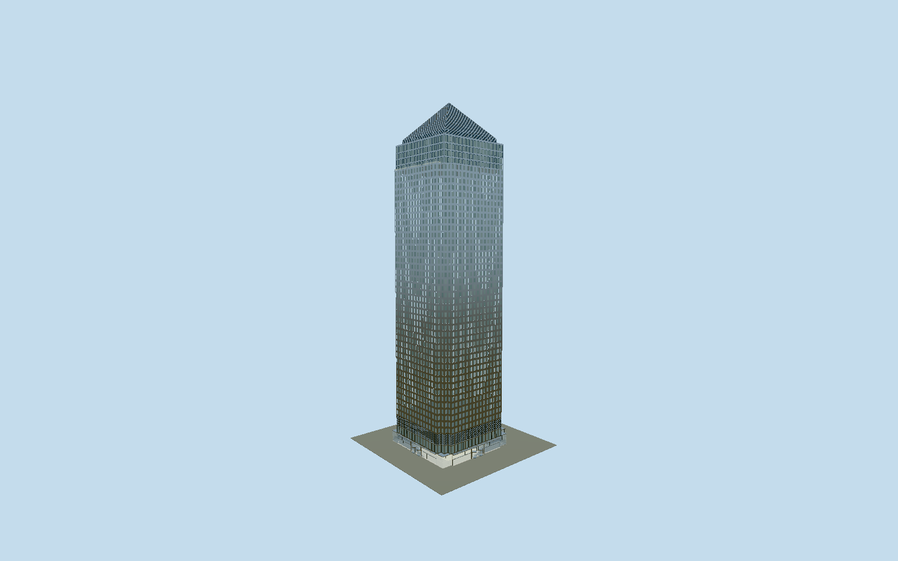

# One Canada Square

One Canada Square: a linen-finish stainless tower with two inward steps at each corner, individually recessed paired windows, four narrower glazed upper storeys, west terrace, folded-louvre pyramid and four entrance elevations with revolving doors.

## Evidence and reconstruction

Published dimensions and reconstructed details are separated in spec.json. Primary references:

- [Reference](https://pcparch.com/work/one-canada-square-and-docklands-light-railway-station)
- [Reference](https://offices.canarywharf.com/wp-content/uploads/2025/07/One-Canada-Square-Brochure_v17g.pdf)
- [Reference](https://images1.loopnet.com/d2/g_LDyTiUwUQh7gLJ-NzRTflr7BdsBQ8ZRfc0XYVIK_8/One%20Canada%20SquareBrochurepdf.pdf)
- [Reference](https://www.entuitive.com/projects/one-canada-square,-canary-wharf)
- [Reference](https://www.skyscrapercenter.com/building/one-canada-square/1040)
- [Reference](https://colt-international.co.uk/solutions/louvre/)
- [Reference](https://websaweprd.blob.core.windows.net/cms-assets-international/2023-06/One%20Canada%20Square_Case_Study.pdf)
- [Reference](https://www.openstreetmap.org/way/5986754)

No third-party geometry, photograph or bitmap texture is embedded. Shared surface graphs come from the central library; vertex tints carry model colors. Glazing uses PBR materials; transparent surfaces are declared per model.

## Model and axes

78,882 triangles; 155,936 vertices; 4 material groups; 6,562,968 bytes. Native bounds: -32.570, 0.000, -30.630 to 32.570, 235.000, 30.630. Source hash: `sha256:dcfe23812cbfefb417ac9d6a400cf551cf7fa16c703e56161524a3830700ca21`.

{"up":"+Y","longitudinal":"+X east-southeast along local street grid","front":"+Z south-southwest","origin":"Mapped lower-envelope center; upper tower center is X=-2.65 m; Y0 is terrain contact."}

The fresh raw OSM way 5986754, tagged Q503477, matches the independently preserved ground outline within 0.002 m rounding. Anchor [-0.019514156, 51.50493389] and heading -0.172600059102 remain fixed. Native +X points ESE at bearing 99.889 degrees toward the asymmetric east entrance projection; +Z points SSW at 189.889 degrees. The shaft centre X=-2.65 m aligns its 57.912 m width with the mapped west and east wall lines, distinct from the 63.145 by 59.259 m base. Owner north-annotated level 35 and 47 plans were actually inspected: two equal inward corner steps, a 154 square metre west terrace and square upper plate independently establish the signed direction. Model Y0 approximates the local apron. Architect 235 m versus registry 236 m is explicitly unresolved, not a surveyed adjustment. The primary supplier confirms nine drums and seven bullnose panels; exact N2/E3/S2/W2 distribution is reconstructed. No footprint replacement.

## Reproduce

Run `node packages/worldgen/scripts/generate-signature-towers.mjs --ids=one_canada_square` (or add `--check`). The generator preserves manually edited masters by checking their baseline hashes. Import through the standard authored-model workflow with optimization disabled; then capture all QA cameras, including shared-surface views.

## Pending work

- The unchanged original oneCanadaSquareStudy.build recipe reproduces its 964,326 triangles and 80,565,028 bytes. The separate reviewed master and four browser levels preserve the asymmetric base, nine open revolving entrances, seven curved bullnose panels, four rotor leaves per drum, two inward steps at each corner, 57.912 m shaft, 41 physical office intervals from 20.5 to 189.01 m, four narrower upper floors, west terrace, closed pyramid, and 235 m beacon. The reviewed master has closed rectangular 0.205 m window reveals. Browser close-up uses connected sloped surrounds and a 0.14 m glass recess; street uses a 0.12 m recess and every fourth office row with solid infill; district has sparse windows on closed steel; skyline omits punched window rhythm. The original recipe preserves paired glazing, transoms, fine joint returns, and hardware. Near drums use 16 sides, 12 curved sector samples, six bullnose samples and 16 by four foot rims. Far levels preserve entrances and leaves while reducing hardware. Street preserves the original seventeen upper mullion positions using folded strips with at most 0.25 m local projection change, and one metre plant louvre pitch. Stainless and marble graphs plus opaque and 52 percent clear palette glass produce four near groups; tinted marble approximates granite. Dimensions, office datum, pyramid proportions and exact entrance allocation remain reconstructions from plans and photographs rather than an as-built survey. The architect 235 m and registry 236 m height discrepancy remains an unresolved datum convention. Hidden interiors, station connection, adjacent retail pavilions, branding and marketing terrace furniture are excluded. Physical device and dense city timings remain pending.

This bundle follows the medium-fi standard. Medium-fi appearance and geographic fit are reviewed separately. Hash-bound visual acceptance is recorded separately after capture inspection.
