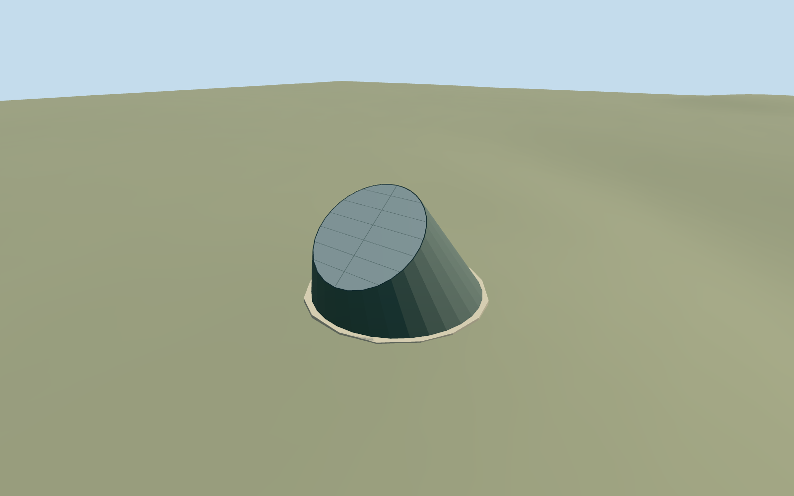

# Peter Harrison Planetarium, Royal Observatory Greenwich

Independent exposed Peter Harrison Planetarium: mapped circular footing, oblique truncated bronze cone, sloping reflective metal cap with dark continuous rim and restrained panel seams. North rim is lower than south; X east/Z south. Preserve the independent South Building, Altazimuth Pavilion and every other campus building. Exterior above-ground cone only: underground theater, entry passages, interiors, furniture, barriers, signs and cafe are outside the mapped shell and omitted.

## Evidence and reconstruction

Published dimensions and reconstructed details are separated in spec.json. Primary references:

- [Reference](https://commons.wikimedia.org/wiki/File:The_Peter_Harrison_Planetarium,_Greenwich_Park.jpg)
- [Reference](https://commons.wikimedia.org/wiki/File:Peter_Harrison_Planetarium.jpg)

Independent exposed Peter Harrison Planetarium: mapped circular footing, oblique truncated bronze cone, sloping reflective metal cap with dark continuous rim and restrained panel seams. North rim is lower than south; X east/Z south. Preserve the independent South Building, Altazimuth Pavilion and every other campus building. Exterior above-ground cone only: underground theater, entry passages, interiors, furniture, barriers, signs and cafe are outside the mapped shell and omitted.

## Model and axes

270 triangles; 712 vertices; 4 material groups; 31,832 bytes. Native bounds: -7.914, -0.864, -7.861 to 7.893, 9.437, 7.760. Source hash: `sha256:5d5e99a2fab239d318333e40f10a2f9c823abff3da10b7496fe0537d838ad5c6`.

{"x":"east","y":"up","z":"south"}

The geographic proposal uses exact-QID OpenStreetMap evidence. Map-derived orientation and estimated architectural details require real-site visual review; preview eligibility is distinct from geographic/fidelity approval. Map attribution: © OpenStreetMap contributors, ODbL-1.0.

## Reproduce

Run `node packages/worldgen/scripts/generate-additional-landmarks.mjs --ids=peter_harrison_planetarium_royal_observatory_greenwich` (or add `--check`). The generator preserves manually edited masters by checking their baseline hashes. Import through the standard authored-model workflow with optimization disabled; then capture all QA cameras, including shared-surface views.

## Pending work

- Independent exposed Peter Harrison Planetarium: mapped circular footing, oblique truncated bronze cone, sloping reflective metal cap with dark continuous rim and restrained panel seams. North rim is lower than south; X east/Z south. Preserve the independent South Building, Altazimuth Pavilion and every other campus building. Exterior above-ground cone only: underground theater, entry passages, interiors, furniture, barriers, signs and cafe are outside the mapped shell and omitted.
- Shared campus Q192988 plus unique way268533449/native35184640622281, the mapped rounded planetarium cone. Own anchor raw[44.7,76.5], X east/Z south, heading0 baked into footprint. Only this parent footprint is owned; South Building, Altazimuth Pavilion and all other campus buildings remain independent. Photo-led north-facing sloped cap and near-vertical north shell establish working orientation; no surveyed engineering claim.
- No mapped height. Working cone base radius about7.4m, low north rim about3.3m/high south rim9.6m, vertical north generatrix and cap inclination about38.5degrees are photo-led geometric approximations. Profile, cap/weld panels and bronze patina are simplified; shared painted-metal graph substitutes for patinated bronze and reflective cap, raw limestone for low exposed base. No unique texture or copied pixels. Underground volume and entrance are not established by this footprint and remain omitted.
- Existing standard Protomaps20261020/Mapzen201x201/6m Observatory extract reused. Uncovered north approach internal[0,-9.5] fixes datum47.67441333333333m. Working footing top0.2m above provider, with closed foundation to original minimum boundary grade. Only mapped occupied parent cuts ground. Approximate native exterior fit inspected on the original hill; boundary grades -0.714..+0.105m leave a modest closed footing on the lower side. Exact paving, buried theater and access levels remain unverified. No bespoke terrain acquisition or broad flattening.

This bundle follows the medium-fi standard. Medium-fi appearance and geographic fit are reviewed separately. Hash-bound visual acceptance is recorded separately after capture inspection.
