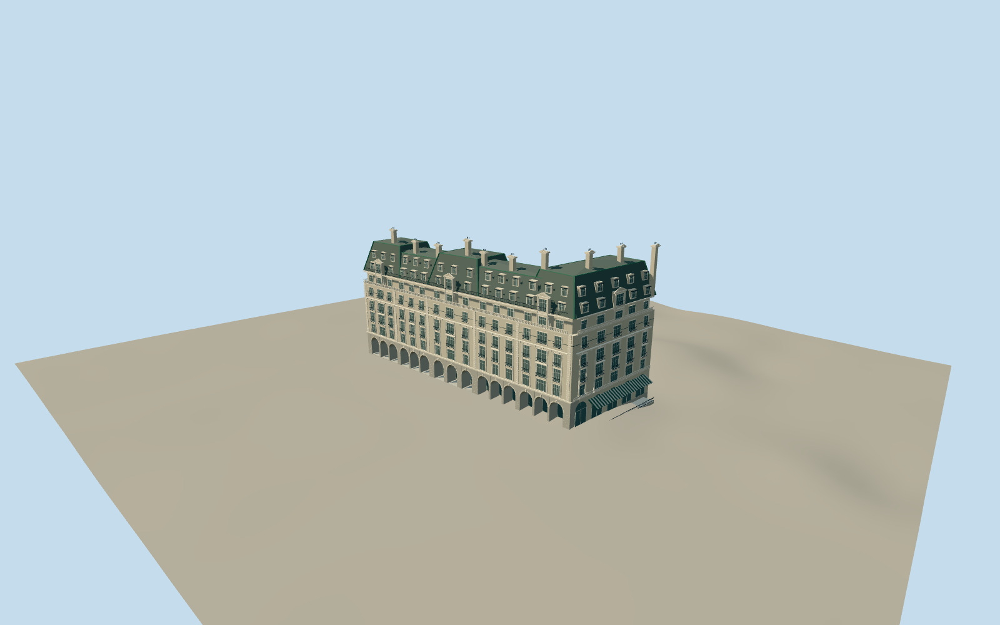

# The Ritz Hotel, London

Historic main hotel: open fifteen-axis Piccadilly arcade, stone facades, three mansard pavilions, copper roof ribs, five-bay Green Park end and lower Arlington entrance with canopy.

Authoring state: **review-in-qa.json**. Current completion evidence is in [qa.json](qa.json) and the [local 100 ledger](../../../../qualla-structures/batches/PROGRESS.md).

- [The Ritz Hotel, London](https://qualla.com/the-ritz-hotel-london/)

Historic main Ritz hotel. New close-range arcade rustication follows the cleared Qualla1907Piccadilly/GreenPark elevations; seven recessed joints on all16piers. Later22Arlington extension and William Kent House remain excluded.

Earlier massing, canopy and roof details inherited from prior work. Modern attribution photographs and private2021survey imagery are excluded as current controls. Full historic-main-hotel fidelity remains pending adequate public-domain review of all retained details.

Joint spacing follows the existing course rhythm;18mm height and25mm depth are authoring estimates. The1907plate does not establish current condition or exact profiles. Close-only construction keeps the three lower geometry levels unchanged.

Dated model scope does not claim to reproduce all current roof/construction changes. No temporary scaffolding, crowds, Christmas decorations or interiors.

Footprint is mapped; vertical dimensions, upper court geometry, rear windows, equipment and fine sculptural profiles are approximations. Main arcade remains open and rear court is not filled to full height.

Original simplified ironwork, stone balustrades and roof ornament; no copied photograph textures, hotel crest or exact lettering.

Independent terrain is unchanged. Deep foundation accommodates the rearward slope; exact contact can differ on another host DEM.

Build: `node packages/worldgen/scripts/generate-authored-places.mjs --ids=ritz_london`. Add `--check` to verify exact regeneration. 55849 triangles; 7 materials; no embedded photographs.
