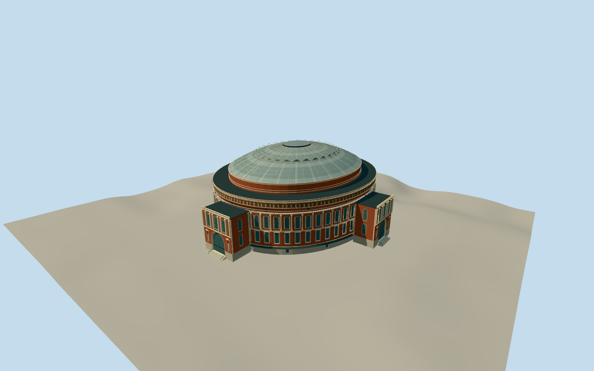

# Royal Albert Hall

Five-stage elliptical red-brick/buff terracotta hall, square lower and round upper window rings, pale pilasters/cornices/open balustrades, brown mosaic band with original abstract pale relief rhythm, stepped upper drum, opaque gridded glazed dome with30radial ribs/white intermediate pediment ring and low oval lantern. Three large N/E/W recessed arched porches and smaller pedimented/oculus south porch with entrance flights. No auditorium interior, adjacent college/mansions, detached chimney/memorials or photo pixels.

Authoring state: **review-in-qa.json**. Current completion evidence is in [qa.json](qa.json) and the [local 100 ledger](../../../../qualla-structures/batches/PROGRESS.md).

- [Royal Albert Hall](https://qualla.com/royal-albert-hall/)

Surviving2012–14 exterior plus current aerial controls form;1986 roof used only as historical comparison and2018temporary scaffolds excluded. Source photographs and primary descriptions inform exterior rather than a surveyed mesh.

Native smooth-ellipse approximation of core73.314m by83.845m and roof58.394m by68.863m with four separately bounded porches; all native vertices retained as controls. Primary MOLA nominal dimensions/street-relative roof36.6m guide vertical hierarchy; database part height43.8/46.6m not treated as same surveyed datum.

Sixty facade bays and30roof divisions preserve visible rhythm; exact bay positions/fine relief/thresholds/doorways and roof glazing subdivisions are original proportional estimates. Original abstract pale figures suggest frieze rhythm without reproducing its artwork or inscriptions.

South lower central arched entrance is proportional reconstruction from1986roof view and2014south photograph; current lower face is partly screened by the separate1851memorial. Door9 image controls recessed threshold details rather than external door count.

Glazing is intentionally opaque for the exterior library. Frieze/pilaster relief and ornamental capitals are simplified; no seating interior/basement, adjacent buildings, detached chimney/memorials, temporary scaffolds/vegetation/crowds/vehicles or photo pixels.

Unchanged original terrain, dry reference18.3328m/fixed-3m foundation/estimated entry thresholds are bounded authoring pose; host terrain compatibility remains dataset-dependent.

Build: `node packages/worldgen/scripts/generate-authored-places.mjs --ids=royal_albert_hall`. Add `--check` to verify exact regeneration. 63569 triangles; 8 materials; no embedded photographs.
