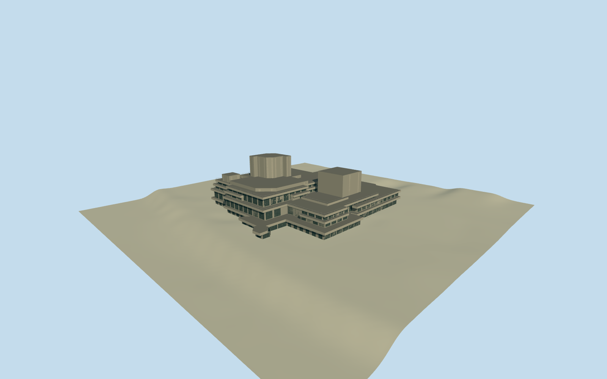

# Royal National Theatre

The Royal National Theatre on the South Bank, with board-marked fly towers, glazed foyers and stepped concrete terraces.

Authoring state: **review-in-qa.json**. Current completion evidence is in [qa.json](qa.json) and the [completion ledger](../../../../qualla-structures/batches/qualla-004.PROGRESS.md).

- [Royal National Theatre](https://qualla.com/royal-national-theatre/)

Interior auditoria, temporary furnishings and lighting are outside the model scope.

Measured native footprint and mapped mass heights guide the shell. Unpublished terrace depths, glazing positions and glazing divisions are estimated.

Build: `node content/worldgen/source/places/gc/gcp/royal_national_theatre/models/generate-royal-national-theatre.mjs`. Add `--check` to verify exact regeneration. 17800 triangles; 6 materials; no embedded photographs.
