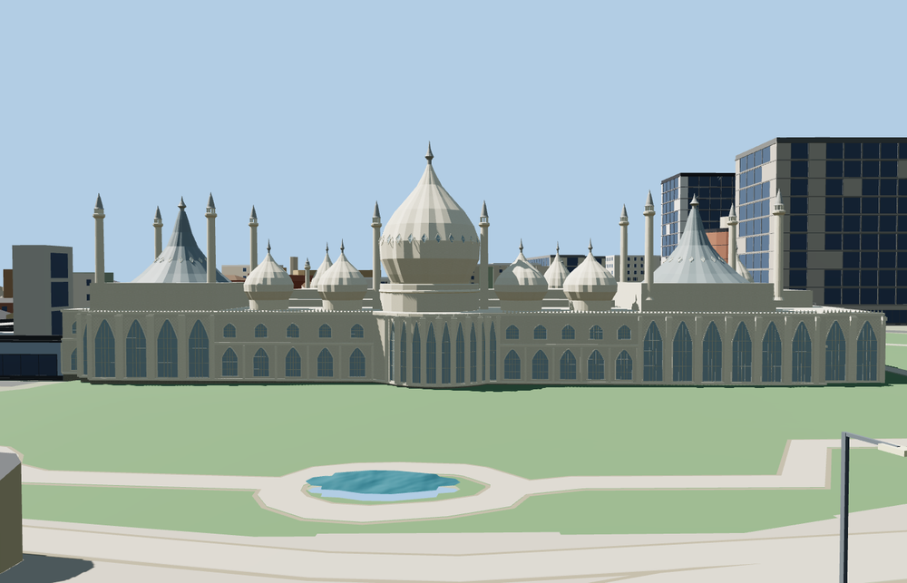

# Royal Pavilion

Brighton’s Pavilion has a ribbed central onion dome, four smaller garden domes, dark concave roofs above the end halls, and slender minarets with open lantern crowns. The east rotunda and end bays have arched lattice screens. A separate domed canopy covers the west entrance.

The 73,774-triangle source rebuilds byte for byte. Skyline, district, street and close-up use 990, 3,967, 15,678, 59,260 triangles. The first two tiers total 401,172 bytes. Six GLBs validated and 36 current views were inspected.

Each tier passes nine foundation, eleven roof crest, fourteen minaret crest and three open canopy probes. The west porch floor is within 0.15 m of the sampled ground and a short graded walk connects to the garden path. The viewer retains 353 independent building records and 138 mapped transportation parts. Failed loading retains the original mapped footprint.

The base footprint and roof centerlines follow the Pavilion and its building parts in PMTiles. Dome profiles, finial heights and ornamental relief are estimated from exterior photographs.

Rebuild with `node packages/worldgen/scripts/generate-royal-pavilion.mjs`. Append `--check` to compare exact bytes. Use `--ids=royal_pavilion` for targeted import, LOD, placement and readiness.
