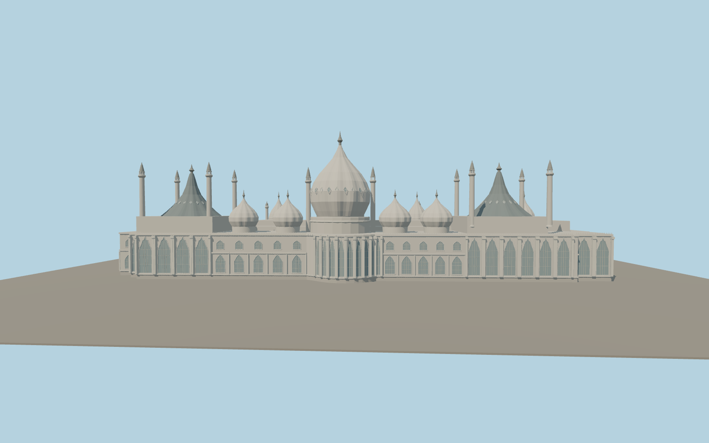

# Royal Pavilion

Brighton’s Pavilion has a ribbed central onion dome, four smaller garden domes, dark concave roofs above the end halls, and slender minarets with open lantern crowns. The east rotunda and end bays have arched lattice screens. A separate domed canopy covers the west entrance.

Run `node packages/worldgen/scripts/generate-royal-pavilion.mjs` to rebuild the source master. Append `--check` to compare the exact bytes. Use `--ids=royal_pavilion` for targeted import, LOD generation and placement.

The base footprint and roof centerlines follow the Pavilion and its building parts in PMTiles. Dome profiles, finial heights and ornamental relief are estimated from exterior photographs.

Original geometry follows the repository license. Map data is © OpenStreetMap contributors under ODbL-1.0 via Protomaps. Terrain samples are described in terrain-grid.json. Ordinary pictures stay local and are not redistributed or used as textures. Current acceptance is recorded in qa.json.
