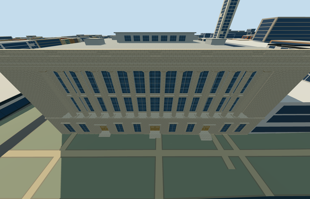

# science_museum — Science Museum

Reviewed 2026-10-23. **Completed medium-fi connected parent exterior; qualified approximate native fit.**

## Built

The complete mapped museum has its pale stone Exhibition Road frontage, fourteen giant Ionic shafts with actual upper recess depth/open gaps, paired tall glazing and stepped cornice/parapet. Three recessed lower entrances have wooden doors, closed soffits/thresholds and supported 4/3/2-tread approaches. The model continues through the brick gallery range to the western modern/glazed block, with approximate clerestory, roof lanterns and plant volumes. Adjacent north buildings and Natural History Museum remain independent.

Seven roles share six existing 256px graphs: stone_limestone, brick, membrane, storefront, metal_painted and wood_plain. Canonical metric UVs, separate vertex streams and equal CPU/GPU geometry accounting. Seven textured draws/one skyline; no embedded images, private atlas or new graph.

| LOD | Triangles | Bytes | Draws |
| --- | ---: | ---: | ---: |
| skyline | 949 | 81,828 | 1 |
| district | 3,117 | 295,396 | 7 |
| street | 12,461 | 1,160,868 | 7 |
| closeup | 39,285 | 3,767,080 | 7 |

Initial skyline + district geometry: **377,224 bytes**. Skyline retains all fourteen shafts and three tread sets. Closeup adds simplified volutes, window-frame geometry, door panel trim and roof details.

## Placement and limits

Q674773 and the named Science Museum POI identify parent way27765411/native35184399854243. The complete 53-vertex mapped outline controls scale and placement. Anchor [-0.17418935894966125,51.4975369418994]; baked east/up/south axes, heading0. Internal X follows the frontage south-southeast and Z points east-northeast toward Exhibition Road. Controls: [map-frame.json](map-frame.json).

Only the occupied museum and three small tread approaches are ground-masked. **2,108 resident / 2,724 wider independent buildings**, original 201x201/6m terrain/roads and **329.595m² water** stay intact. Failure retains all 2,109 resident originals. Every LOD/failure/unload restores ground/water and releases all geometry; each used texture graph reads once.

The outside datum is 9.641758554059692m. Boundary grades -2.899..-.122m, floor+.15m and foundation-3.079m produce supported bases with some downhill exposure. Three short tread sets bridge approximate local entrance grades. Exact thresholds/accessibility, heights, column/bay inventories, hidden details, modern cladding and roof equipment remain approximate. The 2011 aerial supplies rear massing context and does not prove exact current equipment. No bespoke terrain, copied lettering/art, furnished galleries or collection interiors.

The front camera moved into Exhibition Road after the opposite building blocked it. Some very wide portable/shared details crop outer cornice edges; turntables and native context cover the envelope. Flat review planes intersect grade-specific bases/treads. Physical phone/laptop and dense-city measurements remain pending.

## Checks and references

**Six GLBs: zero Khronos errors/warnings; 396 actual mesh/contact probes; 52 current inspected frames; 15 map cases including two detailed fragments of the one owned parent.** Selected generation/import/placement, strict medium-fi, scene/sim30 and two-recipe lint pass. Sim30 sha256:95d0ccc7eb508b3396fbd465742c55a29b00d5b4264226eba777ad5353540069. Current hashes/frame evidence: [qa.json](qa.json).

- [Front photograph](https://commons.wikimedia.org/wiki/File:Science_Museum,_Exhibition_Road_(cropped).jpg): Shadowssettle; crop Ham II;2020-08-01;CC-BY-SA-4.0.
- [Ordinary aerial](https://commons.wikimedia.org/wiki/File:Kensington_Museums_aerial_2011_a.jpg): Andreas Praefcke;2011-06-10;public domain release. Inspected complete view and natural-resolution museum regions.
- [Mapped parent](https://www.openstreetmap.org/way/27765411): ©OpenStreetMap contributors,ODbL-1.0.

Pictures were viewed only; no pixels copied. Two ordinary pictures and standard PMTiles/Mapzen guided one continuous author/inspect/fix pass.
