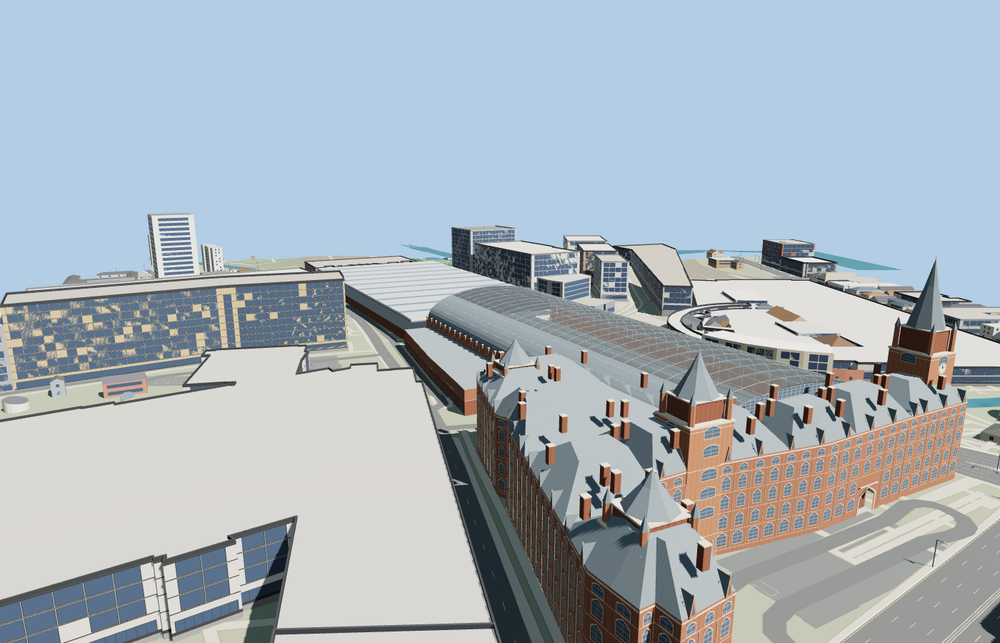

# St Pancras railway station

The Barlow train shed has one broad glazed vault above raised platforms, set against a low modern northern extension. The red-brick Midland Grand frontage adds a recessed entrance, stepped Gothic roofs and the Euston Road clock tower.

The 105,880-triangle source rebuilds byte for byte. Skyline, district, street and close-up use 985, 3,644, 9,303, 55,286 triangles. Skyline and district total 363,500 bytes. Six GLBs validated and 36 current views were inspected.

All four tiers pass the roof, tower, platform, track, apron, underpass and recessed entrance probes. The viewer retains 304 independent building records and 870 transportation records. Failed loading restores both mapped buildings and the three attached parts.

The station and adjoining hotel footprints and the platform edges come from PMTiles. The Barlow roof heights, rail level, Gothic frontage and towers are reconstructed from exterior and train-shed photographs, with standard terrain for street contact. Visible platforms and station elevator volumes are represented. Track centerlines are estimated between mapped platform edges. Hotel interiors and operations below the raised station deck are outside the reconstruction.

Rebuild with `node packages/worldgen/scripts/generate-st-pancras-station.mjs`. Append `--check` to compare exact bytes. Use `--ids=st_pancras_railway_station` for targeted import, LOD, placement and readiness.
