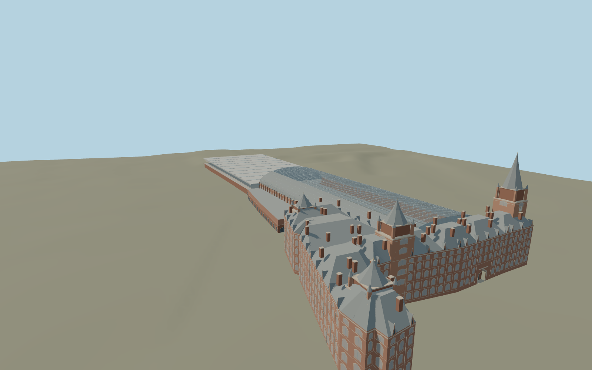

# St Pancras railway station

The Barlow train shed has one broad glazed vault above raised platforms, set against a low modern northern extension. The red-brick Midland Grand frontage adds a recessed entrance, stepped Gothic roofs and the Euston Road clock tower.

Run `node packages/worldgen/scripts/generate-st-pancras-station.mjs` to rebuild the source master. Append `--check` to compare the exact bytes. Use `--ids=st_pancras_railway_station` for targeted import, LOD generation and placement.

The station and adjoining hotel footprints and the platform edges come from PMTiles. The Barlow roof heights, rail level, Gothic frontage and towers are reconstructed from exterior and train-shed photographs, with standard terrain for street contact.

Visible platforms and station elevator volumes are represented. Track centerlines are estimated between mapped platform edges. Hotel interiors and operations below the raised station deck are outside the reconstruction.

Original geometry follows the repository license. Map data is © OpenStreetMap contributors under ODbL-1.0 via Protomaps. Terrain samples are described in terrain-grid.json. Ordinary pictures stay local and are not redistributed or used as textures. Current acceptance is recorded in qa.json.
