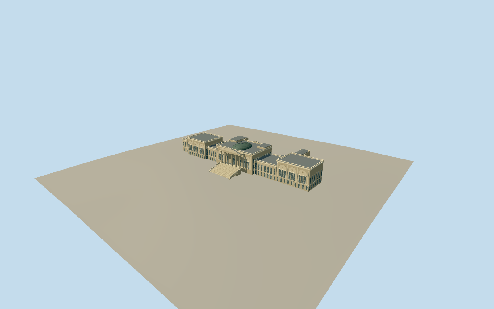

# Stowe House

Neoclassical main house with six-column Corinthian south portico and broad stairs, triple-arched end pavilions, lower Ionic links, oval copper dome, four-column Ionic north entrance with clock pediment, corner towers and two open curved north colonnades.

Authoring state: **review-in-qa.json**. Current completion evidence is in [qa.json](qa.json) and the [local 100 ledger](../../../../qualla-structures/batches/PROGRESS.md).

- [Stowe House](https://qualla.com/stowe-house/)

Current construction uses two exact native cleared Qualla photographer-CC0 south-front/capital-detail originals. Six close capitals use closed layered leaf stocks and corner volutes; original house/wings/steps retained. Earlier attribution/private conservation/aerial sources are historical and excluded. Broader north/hidden roof fidelity remains pending; dimensions, leaf/scroll profiles and current condition are estimates.

Main house, flanking pavilions and links, north curved colonnades and south steps only; attached service courts, separate garden temples, freestanding statues and interiors excluded.

Independent unmodified Terrarium terrain retained; ground beneath buildings is interpolated composite evidence. Host terrain can differ. Footprint replacement disabled.

Corinthian acanthus, Ionic volutes, roundel sculpture, lions and fine carved ornament simplified or omitted. No photographic textures and no physical-device performance measurement.

Build: `node packages/worldgen/scripts/generate-authored-places.mjs --ids=stowe_house`. Add `--check` to verify exact regeneration. 62407 triangles; 6 materials; no embedded photographs.
