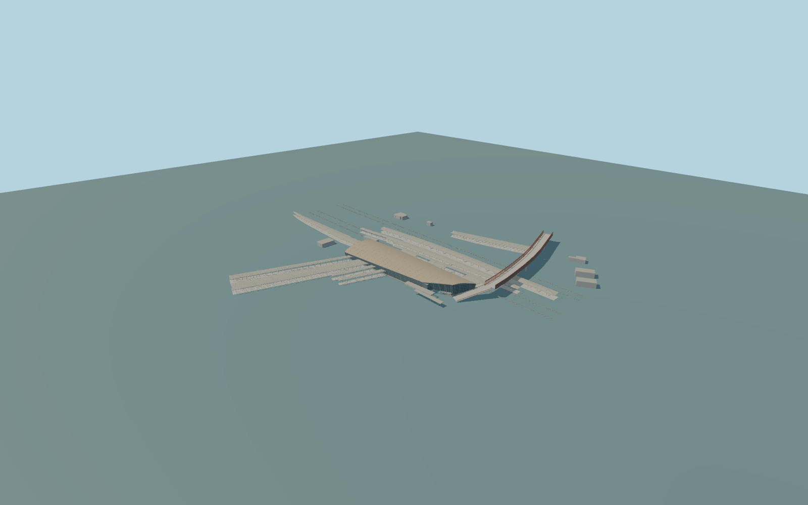

# Stratford railway station

Complete aboveground Stratford regional interchange exterior:whole sweeping Meridian Square ticket hall/main roof andwest platform extension;both long mainline island canopies;curved northwestern Overground-platform canopy andservice shelters;four southern Jubilee/DLR platform-canopy outlines;east glazed entry/lift andMeridian facade canopy;complete mapped rust-framed glazed public footbridge across therails,including approximate southlanding/stairs. Stratford International,Westfield mall,adjacent office/retail towers,busstation,independentstreets andnonstationbuildings remain separate. Underground interiors,trains,people,lettering,roundels andadvertising are omitted.

Rebuild: `node packages/worldgen/scripts/generate-stratford-station.mjs`;append `--check` for exact source bytes. Select import/LOD/placement with `--ids=stratford_railway_station`. Detailed source and four browser tiers are separate ignored GLB outputs.

Complete aboveground Stratford regional interchange exterior:whole sweeping Meridian Square ticket hall/main roof andwest platform extension;both long mainline island canopies;curved northwestern Overground-platform canopy andservice shelters;four southern Jubilee/DLR platform-canopy outlines;east glazed entry/lift andMeridian facade canopy;complete mapped rust-framed glazed public footbridge across therails,including approximate southlanding/stairs. Stratford International,Westfield mall,adjacent office/retail towers,busstation,independentstreets andnonstationbuildings remain separate. Underground interiors,trains,people,lettering,roundels andadvertising are omitted.

Current PMTiles mainparent height11m retained asmainroof crown;canopy531andfour southerncanopies native5m retained asrooftops. The mainroof fillsmapedge service/notch gaps withanordinary-picture convex roof-envelope interpretation;actual occupiedfloorremains theinset mainhall only. Layer-1 doesnot establish surveyed platformgrade. Eaves5.4m,glasswall6m,platform .3m,mainfloor .65m,mainfootbridgefloor7.8m/side11m andauxiliaryserviceheights areexplicit photo/map approximations. Footbridgefollows current mappedpath35184502965940;its fullphysical crossingisclaimed,not thewhole adjoiningmall. One unchanged standardglobal field sampleoutsideMeridianSquare at[85,60],5.109632m,definesY=0. Mainfloor+.65m;footings-8m. No perpart runtimehostoffsets orflattening.

Three ordinary exterior photographs/currentstandardPMTiles. Whole aboveground scopeisretained,including open-top footbridge;hiddeninteriors,roofsectionprofiles,framecounts,stairgradients andplatformgrades areexplicit medium-fi estimates. No surveyedthreshold/accessible routeclaim. StratfordInternational,Westfield,independenttowers/busstation excluded. Physical laptop/phone/dense-city timings andnumericalLODerrors remain unmeasured.

Six existing shared256px graphs:stone_limestone,stone_granite,metal_standing_seam,metal_painted,window_grid andmembrane. Atmost6mergedsemantic groups,metricUVs,linearcolors;zero embedded/privateimages. Onlyactualglassfacades/footbridgesides usewindow_grid;opaqueroofs,posts,railsteel,concrete retainsemantics. Fourwhole-structuretiers preservemaincurvedroof,allcanopyfamilies,wholefootbridgeandactualinsetfloor;nearlevelsaddstructuralribs,supports,slopedglazing/recessedentry,mappedbridgebays/columns,stairsandrailbeds. Masterseparatelyrefinesroofpatches,glazing,ribs,framesandsleepers.

Original geometry:repository license. Map:© OpenStreetMap contributors,ODbL-1.0;Protomaps. Standard terrain:terrain-grid.json. Ordinary pictures stay local and are not redistributed or used as textures. Current acceptance:qa.json.
