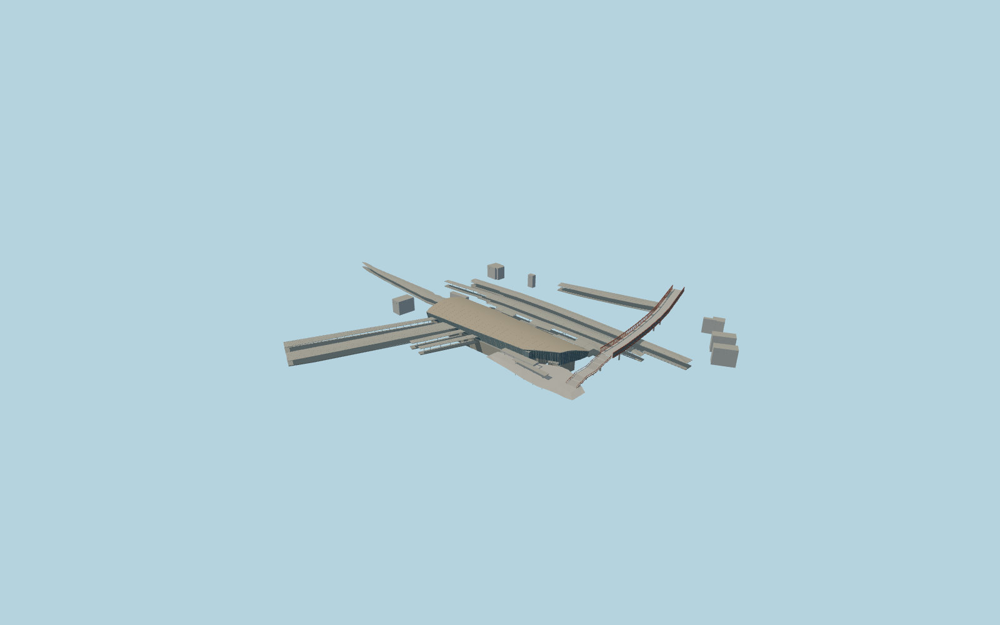

# Stratford railway station

The Stratford regional interchange with its curved glazed Meridian Square hall, open canopy rows and platform slabs, eastern lift, rust-framed public footbridge and five flights of the mapped Meridian Steps.

Rebuild: `node packages/worldgen/scripts/generate-stratford-station.mjs`;append `--check` for exact source bytes. Select import/LOD/placement with `--ids=stratford_railway_station`. Detailed source and four browser tiers are separate ignored GLB outputs.

Platform grades, canopy supports and steps are visual reconstructions from standard terrain, mapped rail alignments and ordinary photographs. They have no surveyed rail clearances or accessibility data.

The Westfield-side footbridge end is modeled to its mapped endpoint. The shopping centre, bus station, Stratford International and underground railway interiors use their own scene data.

Original geometry:repository license. Map:© OpenStreetMap contributors,ODbL-1.0;Protomaps. Standard terrain:terrain-grid.json. Ordinary pictures stay local and are not redistributed or used as textures. Current acceptance:qa.json.
