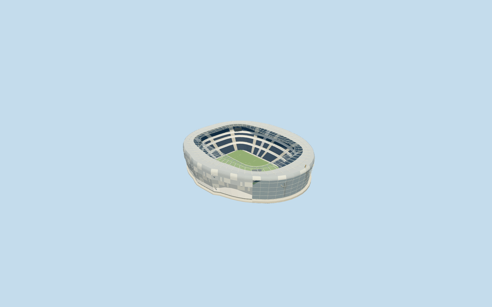

# Tottenham Hotspur Stadium

Specific Tottenham Hotspur Stadium in neutral football configuration: own native oval envelope/smaller lower bowl opening and separate picture-estimated larger roof aperture, pale staggered projecting silver panel skin/rounded ribbed crown/west entrance glazing, supported radial roof frame/curved stays and paired inner cable ring/glazed leading strip, continuous single-bank South Stand and multi-bank side/north stands with closed hospitality belts/pale aisles, large convex south glazed atrium with two visible branching tree supports/owned floors and contacts, four supported neutral corner displays/football field/goals and small original roof cockerel/ball silhouette. Six existing shared graphs plus image-free transparent PBR glass for actual visibility through the atrium/roof; no private textures/copied crowd/event/seat graphics/furnished hidden rooms/whole precinct slab. The static field does not implement a moving/NFL conversion system.

## Evidence and reconstruction

Published dimensions and reconstructed details are separated in spec.json. Primary references:

- [Reference](https://populous.com/showcases/tottenham-hotspur-football-club)
- [Reference](https://commons.wikimedia.org/wiki/File:Spurs_stadium_south_stand_cropped.jpg)

Specific Tottenham Hotspur Stadium in neutral football configuration: own native oval envelope/smaller lower bowl opening and separate picture-estimated larger roof aperture, pale staggered projecting silver panel skin/rounded ribbed crown/west entrance glazing, supported radial roof frame/curved stays and paired inner cable ring/glazed leading strip, continuous single-bank South Stand and multi-bank side/north stands with closed hospitality belts/pale aisles, large convex south glazed atrium with two visible branching tree supports/owned floors and contacts, four supported neutral corner displays/football field/goals and small original roof cockerel/ball silhouette. Six existing shared graphs plus image-free transparent PBR glass for actual visibility through the atrium/roof; no private textures/copied crowd/event/seat graphics/furnished hidden rooms/whole precinct slab. The static field does not implement a moving/NFL conversion system.

## Model and axes

45,228 triangles; 135,684 vertices; 7 material groups; 5,431,628 bytes. Native bounds: -106.408, -1.259, -114.825 to 101.588, 52.000, 127.907. Source hash: `sha256:13057dbcf8720a6252e644ea79a55d96955c074d47d8e732be4a427a782a38a9`.

{"x":"east","y":"up","z":"south"}

The geographic proposal uses exact-QID OpenStreetMap evidence. Map-derived orientation and estimated architectural details require real-site visual review; preview eligibility is distinct from geographic/fidelity approval. Map attribution: © OpenStreetMap contributors, ODbL-1.0.

## Reproduce

Run `node packages/worldgen/scripts/generate-additional-landmarks.mjs --ids=tottenham_hotspur_stadium` (or add `--check`). The generator preserves manually edited masters by checking their baseline hashes. Import through the standard authored-model workflow with optimization disabled; then capture all QA cameras, including shared-surface views.

## Pending work

- Specific Tottenham Hotspur Stadium in neutral football configuration: own native oval envelope/smaller lower bowl opening and separate picture-estimated larger roof aperture, pale staggered projecting silver panel skin/rounded ribbed crown/west entrance glazing, supported radial roof frame/curved stays and paired inner cable ring/glazed leading strip, continuous single-bank South Stand and multi-bank side/north stands with closed hospitality belts/pale aisles, large convex south glazed atrium with two visible branching tree supports/owned floors and contacts, four supported neutral corner displays/football field/goals and small original roof cockerel/ball silhouette. Six existing shared graphs plus image-free transparent PBR glass for actual visibility through the atrium/roof; no private textures/copied crowd/event/seat graphics/furnished hidden rooms/whole precinct slab. The static field does not implement a moving/NFL conversion system.
- RetainedQ55074091 and named native stadiumPOI35184910389087 establish individual parent52776565841254. All four tile fragments of pitch35185009030811 are unioned before measuring105.184966x67.576832m field axis. Own anchor[-0.06622974820272659,51.6042075675057]/heading0/native east-south/internal X[0.06343176603145521,0.9979861777891168]/Z[-0.9979861777891168,0.06343176603145521]. Positive internalX is almost geographic south and holds the single-bank stand/branching atrium. Native72-point outer controls approximately243x207m body;44-point117x81m hole controls lower bowl/runoff, not the larger visible roof aperture. Working roof aperture is1.38times that hole, approximately161x112m, as a photograph-led estimate. Independent north records and historic western street frontage are retained. Fine20degree/2m facing, panel and branch inventories remain approximate.
- No qualified native architectural height. Working original datum defines fieldY0; facade4..40m/crown40..46m/roof45.5..46m with1.5m sag/inner lower ring43.3m above field are picture-led. Single South Stand1.4..36m is distinct from four approximate side/north banks1.4..10/14..21/25..28/32..38m and closed inter-tier belts. Two approximate tree forks17m/branch tips31..33m/small roof cockerel about5.7m above roof, four display/panel/cable/row counts and entrance arch remain visual allocations. Photos from the designer and2020 South Stand view define the completed-reference era; the2018 upload directory is not an exposure date. No surveyed dimensions beyond map-derived plan controls, engineering/access certification or exact material optics. Opaque shared glazing and image-free18percent-alpha south/roof panes approximate real reflection/transmission. Hidden furnished bar/interiors and functional retractable-field machinery are excluded.
- Original standard6m Mapzen grid/roads/water and independent context remain unchanged. Original datum11.890147258790762m defines field/modelY0; boundary samples approximately-.659..1.894m. Own retaining floor extends below minimum original grade, while the bounded opening stays inside every level occupied floor. Tree pads and rear posts meet original sampled contacts; atrium floors are supported within the owned body. Only main stadium parent52776565841254 is replaced using99.5percent whole-feature coverage; lower-zoom merged complexes use bounded area clipping. Do not remove the independent northern development, historic west houses or extend a platform over streets/precinct. Failure/unload preserves or restores original terrain/context.

This bundle follows the medium-fi standard. Medium-fi appearance and geographic fit are reviewed separately. Hash-bound visual acceptance is recorded separately after capture inspection.
