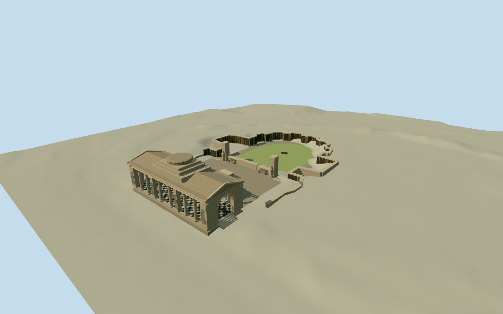

# Tower Hill Memorial

Lutyens’s Portland stone Merchant Navy pavilion and Maufe’s adjoining sunken bronze memorial garden at Tower Hill.

Authoring state: **review-in-qa.json**. Current completion evidence is in [qa.json](qa.json) and the [completion ledger](../../../../qualla-structures/batches/qualla-004.PROGRESS.md).

- [Tower Hill Memorial](https://qualla.com/tower-hill-memorial/)

Pavilion roof profile and individual pylon heights are reconstructed from photography at model scale. The plates, decorative relief blocks and compass convey the forms of the memorial at medium detail. Engraved names and individual sculptural likeness are outside the model scope.

Nearby park, 2005 Falklands monument, and unrelated buildings remain supplied by the existing world.

Build: `node content/worldgen/source/places/gc/gcp/tower_hill_memorial/models/generate-tower-hill-memorial.mjs`. Add `--check` to verify exact regeneration. 11742 triangles; 6 materials; no embedded photographs.
