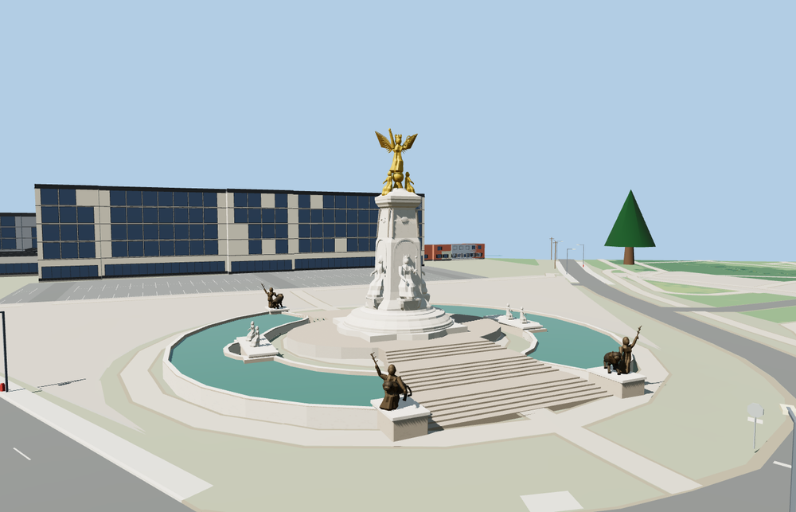

# Victoria Memorial

London Victoria Memorial with the paired curved pools and stair flights, four bronze lion groups, seated queen, allegorical figures and gilded Winged Victory.

The 51,069-triangle source rebuilds byte for byte. Skyline, district, street and close-up use 937, 3,625, 10,451, 43,389 triangles. The first two tiers total 386,848 bytes. Six GLBs validated and 38 current views were inspected.

All four tiers pass eight pool, four outside-water, eighteen stair, and six sculpture-base probes. The near sculpture reaches 25.94 metres at the raised hand. The viewer retains 26 independent buildings, 146 mapped transportation parts. Failed loading restores the five original building features and both original fountain basins.

Sculpture anatomy, carved details and minor fountain fittings are medium-fi interpretations of the exterior photographs. Water in the pools is represented by static surfaces. The outline, basin polygons, statue points and The Mall supply the main layout. Steps and elevations follow standard terrain and visual proportions. Physical-device timings are unmeasured.

Rebuild with `node packages/worldgen/scripts/generate-victoria-memorial.mjs`. Append `--check` to compare exact bytes. Use `--ids=victoria_memorial` for targeted import, LOD, placement and readiness.
