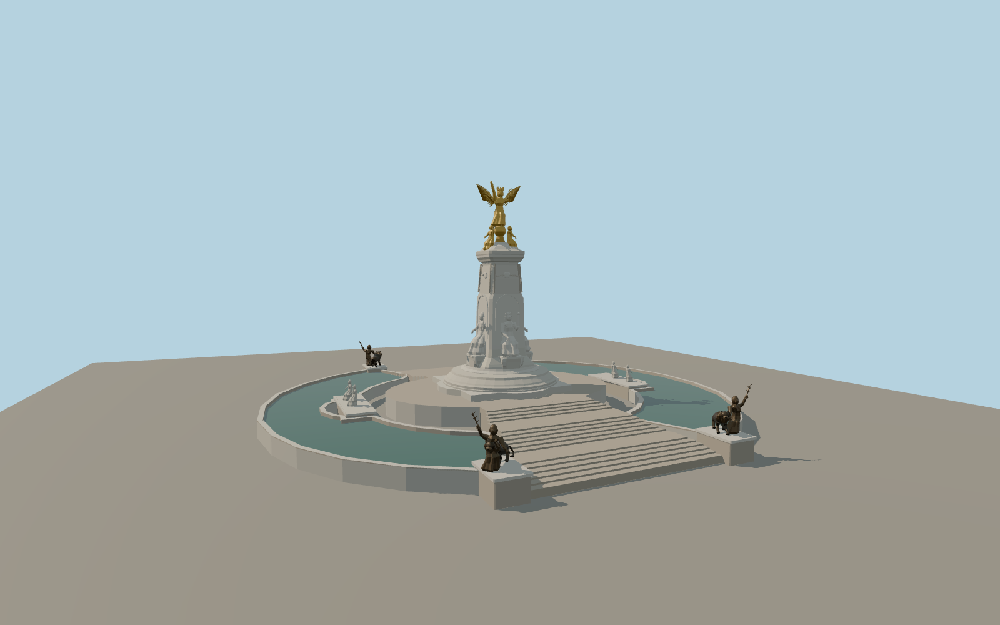

# Victoria Memorial

London Victoria Memorial with the paired curved pools and stair flights, four bronze lion groups, seated queen, allegorical figures and gilded Winged Victory.

Run `node packages/worldgen/scripts/generate-victoria-memorial.mjs` to rebuild the source master. Append `--check` to compare the exact bytes. Use `--ids=victoria_memorial` for targeted import, LOD generation and placement.

Sculpture anatomy, carved details and minor fountain fittings are medium-fi interpretations of the exterior photographs. Water in the pools is represented by static surfaces.

The outline, basin polygons, statue points and The Mall supply the main layout. Steps and elevations follow standard terrain and visual proportions.

Original geometry follows the repository license. Map data is © OpenStreetMap contributors under ODbL-1.0 via Protomaps. Terrain samples are described in terrain-grid.json. Ordinary pictures stay local and are not redistributed or used as textures. Current acceptance:qa.json.
