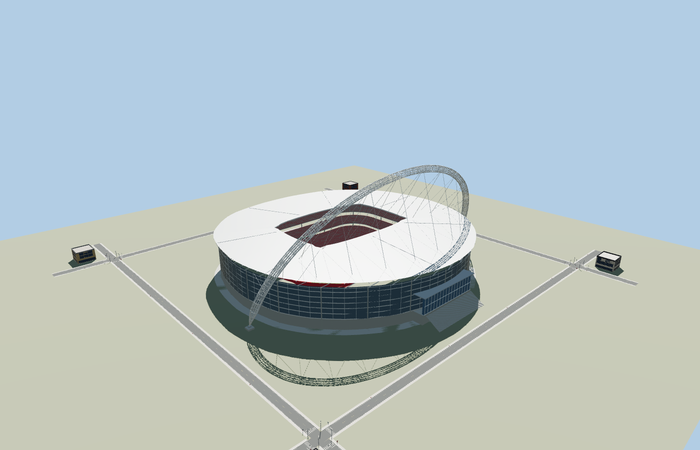
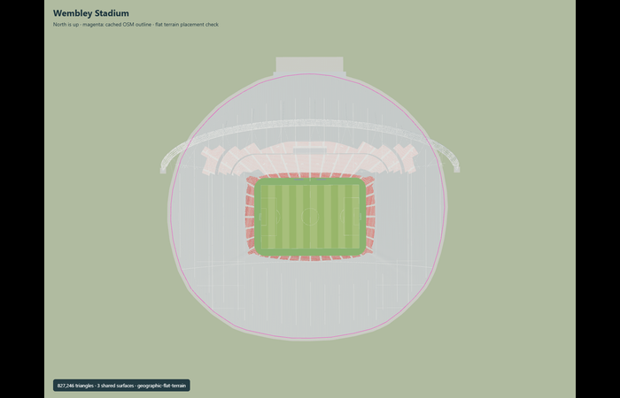

# Wembley Stadium

Reviewed2026-10-31. **Full-detail master corrected;four budgeted browser tiers and retained approximate geographic scope accepted.**

Inspected68 final current frames:11 portable and11 shared-material views of the corrected detailed master,27 Earth/context/LOD views and19 actual Molen runtime-placement views. The inclined north-side315m arch,the open mapped roof,the glazed/precast envelope,north Olympic Way entrance/steps and three red seating tiers remain recognizable. Browser skyline has a solid tapered arch;district has six aggregated chord paths;street and closeup retain twelve. Street has22grouped tread levels;closeup has all81row bands,42arch diaphragm rings,selected braces/stays,roof framing,perimeter truss,screens,royal-box volume and40entrance steps. Initial review caught the missing browser perimeter truss and upper seating protruding through southern corners. Both the detailed source and browser geometry now fit the upper tiers inside the mapped envelope;final overhead and side renders confirm the correction.

Three shared256px metal_painted,metal_standing_seam and concrete_plain graphs with metric UVs and linear vertex colors. Seating,blue-gray glazing,turf and dark screens use local PBR palette factors. No private or embedded images. All four browser tiers use six draws. Each shared graph is loaded once in each fixture. Browser north roof glazing is represented by opaque standing-seam cladding;the detailed master retains its translucent north strip. Fine rails/cables,seat counts and panel machinery are deliberately aggregated or omitted from browser levels.

| Level | Triangles | Bytes | Draws |
| --- | ---: | ---: | ---: |
| skyline | 744 | 62176 | 6 |
| district | 3706 | 284316 | 6 |
| street | 15914 | 1114476 | 6 |
| closeup | 62710 | 4188656 | 6 |

Detailed master retains full component/seating representation with827,246triangles /72,462,592source bytes. The old832,058-triangle master had a rounded-rectangle upper-row corner overshoot;fitting those rows recomputes their approximate chair population,without simplifying individual chairs,removing row bands or reducing structural detail. Browser triangles 744 / 3706 / 15914 / 62710,bytes 62176 / 284316 / 1114476 / 4188656. Initial skyline+district 346492bytes;closeup 4188656bytes. Every ceiling and eight-draw maximum passes;POSITION/NORMAL streams are separate. Error settings8/4/2/1m are authoring estimates,not certified Hausdorff bounds. Physical laptop/phone and downtown timing remain unmeasured.

Mapped roof and aperture loops, pitch axis and arch feet anchor the exterior. North-up placement aligns the long east-west field and north-facing arch/entrance. The designer-established 22-degree north arch inclination is retained; artistic OSM arch heights were not used. Retained anchor[-0.27956525,51.55596295],heading0.003693795533106074,native+X east along the goal axis and+Z south are unchanged. The22degree inclined arch stands north(-Z). The existing independently mapped roof outer/opening polygons and pitch remain the plan controls. No new bespoke engineering research,PMTiles/DEM download or geodetic survey was performed.

Actual Molen structure,terrain,worldgen and material/rendering stack on a synthetic flat ground datumY0. All five loaded outputs replace the selected stadium shell while four independent building records and four roads remain unchanged. All1089raw heights and outside-ground probes remain unchanged. The field remains at ground level,with visible turf/markings betweenY0andY0.06;all63inset mapped edge samples find the plaza slab atY0.025. No terrain cutout is required. Hide/show leaves the ground atY0. Failed loading retains all five procedural building records and all roads;unloading leaves zero live model/support geometries and retains original ground. This proves scoped transform/contact/lifecycle behavior,not Wembley terrain heights or current neighboring buildings.

## Reconstruction limits

- Static roof covering all seats while keeping the pitch open; movable panel motion, bogie internals, ticket-seat count and event advertisements are outside this exterior model. Structural connection plate schedules, field margins and smaller mullion dimensions are reconstructed from published photographs. The visible arch and roof structure preserve published section dimensions, but no structural analysis certification or engineering survey is claimed.
- Detailed source and imported design-time master retain their complete detail,with an upper-row envelope-fit correction. Four independently authored browser models retain the315m inclined arch,saddle-free open fixed roof,mapped asymmetric envelope,north Olympic Way entrance and three red seating tiers. Individual chairs,handrail hardware,small glazing joints and roof machinery remain in the detailed source or outside exterior scope.
- Skyline uses24 perimeter facets and one solid tapered arch with20segments and six sides. District uses40facets,six aggregated chords,seven diaphragm rings and diagonal bracing. Street uses60facets,twelve physical chord paths with24segments,11diaphragm rings,selected braces,22grouped tread levels and coarse entrance steps. Closeup uses88facets,twelve64segment chords,42diaphragm rings,selected diagonal web/stay members,all81row bands and40entrance steps. Small cables are widened in distant tiers to stay visible.
- Three existing shared256px painted-metal,standing-seam metal and plain-concrete graphs use metric UVs. Red seats,blue-gray glazing,turf and screens use local PBR factors. No private or embedded images. Browser north roof glazing is aggregated into the opaque metal annulus. Seven simple panel divisions represent the stationary covering;moving panels,roof motion and detailed bearing assemblies are not animated.
- Retained anchor[-0.27956525,51.55596295],heading0.003693795533106074,native+X east along the goal axis and+Z south remain unchanged. The arch stands to the north(-Z),inclined22degrees. Mapped pitch and outer/opening polygons remain the controls;playing field and bearing feet useY0. This is an architectural relative datum,not a new terrain or geodetic survey. No new bespoke source or terrain fetch.
- Error settings8/4/2/1m are authoring estimates,not certified whole-mesh Hausdorff distances. Faceting,sparser distant arch members,grouped tread bands and static detail transitions remain visible when levels are forced close. Physical phone/laptop and downtown timing remain unmeasured.
- The full detailed master and browser tiers fit upper seating rows within93.5percent of the retained mapped outer radius. This corrects the earlier rounded-rectangle southern-corner overshoot while keeping all81row bands,individual chair geometry and full structural detail;the approximate chair population is recomputed from the corrected perimeter rather than retained as an exact ticket-seat count. The original pre-fit master hashes and review remain recorded as historical provenance;current masters and browser levels have fresh hashes and render review. The browser perimeter roof truss is explicit geometry.

## Reproduction

`node packages/worldgen/scripts/generate-stadium-models.mjs --ids=wembley_stadium --check`

`node packages/worldgen/scripts/import-structure-models.mjs --ids=wembley_stadium --check`

`node packages/tooling/scripts/generate-landmark-lods.mjs --ids=wembley_stadium`

`pnpm exec vitest run test/wembley-browser.test.mjs` from packages/tooling. All passed. Six clean GLBs;current scene validates and simulates30ticks with zero events.
