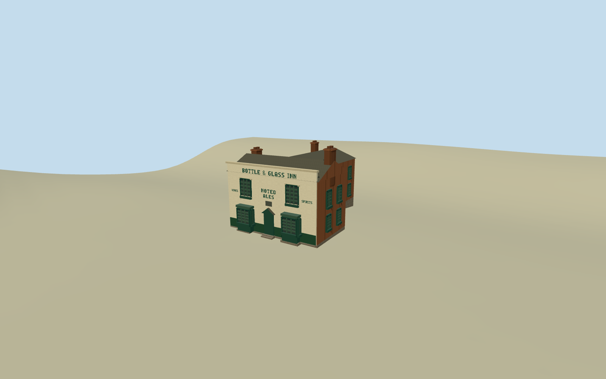

# Bottle & Glass Inn, Dudley

The canalside village inn with its cream and green painted pub frontage and brick rear ranges.

Authoring state: **review-in-qa.json**. Current completion evidence is in [qa.json](qa.json) and the [completion ledger](../../../../qualla-structures/batches/qualla-004.PROGRESS.md).

- [Black Country Living Museum](https://qualla.com/black-country-living-museum/)

The model covers the inn and its attached ranges. The village’s other independent buildings remain outside this placement.

Street elevation, window count, cream and green painted front and historic lettering follow the Qualla photo. Rear openings and small secondary ornament are representative.

Build: `node content/worldgen/source/places/gc/gcq/bottle_and_glass_inn_dudley/models/generate-bottle-and-glass-inn-dudley.mjs`. Add `--check` to verify exact regeneration. 3653 triangles; 7 materials; no embedded photographs.
