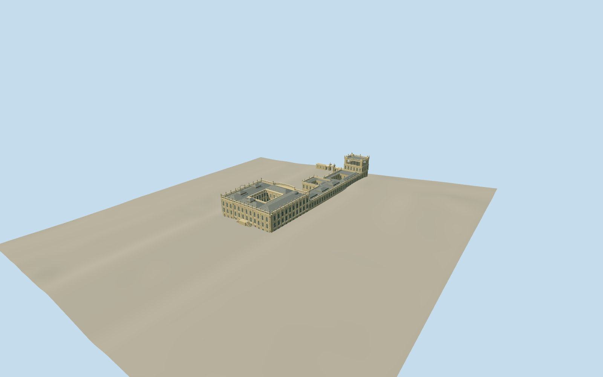

# Chatsworth House

Sandstone quadrangular house with open court, distinct pedimented west and pilastered south/east elevations, bowed north range, balustrades and urns; long attached gallery wing, glazed orangery, tall open belvedere and three-arch return gate.

Authoring state: **review-in-qa.json**. Current completion evidence is in [qa.json](qa.json) and the [local 100 ledger](../../../../qualla-structures/batches/PROGRESS.md).

- [Chatsworth House](https://qualla.com/chatsworth-house/)

Original medium-fi exterior from six individually inspected local Qualla photographs, four-page official visitor plan, Historic England architectural description and aerial/map context. Dimensions, hidden roof joins and fine ornament remain estimates; visitor plan is not a measured survey.

Main house, courtyard, attached north wing, orangery, belvedere and west-return gateway only. Separate stables, gardens, sculpture, interiors, furnishings, vegetation and photographic pixels excluded.

Independent unmodified Terrarium elevations retained. Elevations beneath structures are interpolated evidence, not a building survey; footprint replacement remains disabled.

Carved capitals, pediment relief, urn ornament, window surrounds and balusters are simplified progressively with distance; no physical-device performance measurement claimed.

Build: `node packages/worldgen/scripts/generate-authored-places.mjs --ids=chatsworth_house`. Add `--check` to verify exact regeneration. 62060 triangles; 4 materials; no embedded photographs.
