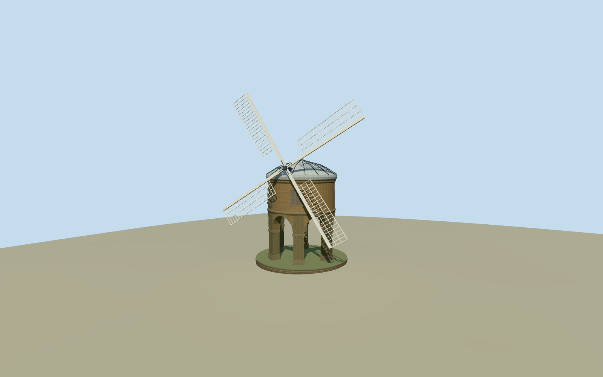

# Chesterton Windmill

Chesterton’s stone tower windmill with an open six-arch arcade and four white lattice sails.

Authoring state: **review-in-qa.json**. Current completion evidence is in [qa.json](qa.json) and the [completion ledger](../../../../qualla-structures/batches/qualla-004.PROGRESS.md).

- [Chesterton Windmill](https://qualla.com/chesterton-windmill/)

The archived public-domain photos support the arcade, cap and sail silhouette. Small moulding and sail rail profiles and cap azimuth are approximate.

Scope includes the surviving mill and its shallow platform. The internal mechanism is outside this exterior model.

Build: `node content/worldgen/source/places/gc/gcq/chesterton_windmill/models/generate-chesterton-windmill.mjs`. Add `--check` to verify exact regeneration. 7476 triangles; 7 materials; no embedded photographs.
