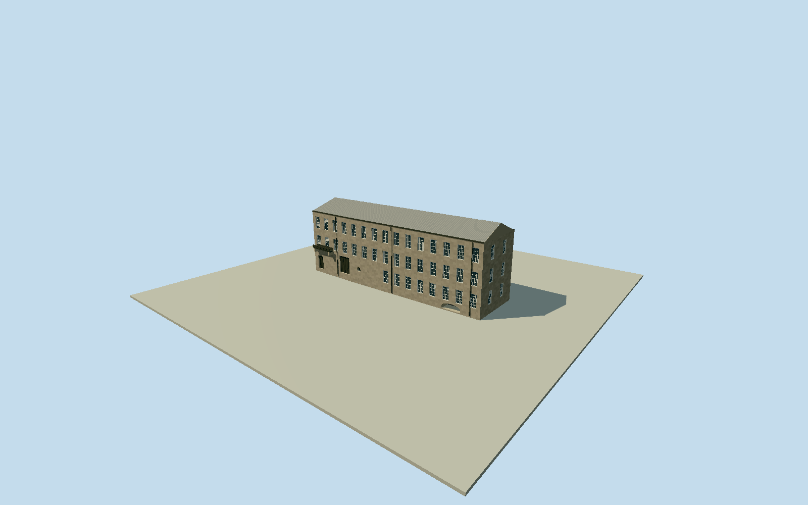

# Cromford First Mill

Complete surviving First/Upper Mill at Cromford (Building18/NHLE1248010), the original1771mill plus1785northextension: wholethree-storeygritstonebody/all15historicbaysincludingtwoformerlyoccludedbyseparateBuilding17, low graygable roof, sashfenestration/flatvoussoirheads/stonebanding, northend2bayfacade, roadendblockedworkers/takingindoors, eastwheelopening/roundshaftaperture andshortremainingcastiron aqueduct atclassicaldoor, lowarchedBonsallBrookculvert mouth beneathnorthaddition. SeparatelylistedBuilding17/14-16/21/26, SecondMillruins andothermillcampusbuildings are independentcompanionstructures, excluded/notcountedbuilt. No restoredlostupperstoreys/workinghistoricwheel, fullcampusrectangle/yardground/naturalcliff/riverwater/trees/parking/interiors. ThreepublishedexactPDselforiginals andprimary2024text control permanent exterior. Use sixpointplan scaledbeforefield toprimary28.3x8m; originalnative41.37x11.25m is independentlystoredcoarsegeographicproxy, notsilentlyreshaped. Preserve15bay/threefloor rhythm, 16paneupper/20panegroundsashes, coursedmillstonegrit/ashlarlowerwheelinfill, realrecessedblockedopenings/roundshaftaperture/segmentalculvertmouth/shortvault, lowcorrugatedgrayroof/edgefascialips andsmallcastironaqueductremnant. No missingfive-storeyroof reconstruction orothercampusstructures/yard/cliff/water. Freezeindependent256m129²fieldbeforegeometry; retainallsamples/rawtilebytes.

Authoring state: **review-in-qa.json**. Current completion evidence is in [qa.json](qa.json) and the [completion ledger](../../../../qualla-structures/batches/qualla-002.PROGRESS.md).

- [Cromford Mill](https://qualla.com/cromford-mill/)

Nativeway1544681099 expressly Building18/NHLE1248010 distinguishes FirstMill fromabuttingBuilding17/otherseparatelylistedcampusbuildings. Original6pointnativeperimeter andanchor/headingpreserved beforegeometry. Its coarse41.372x11.247menvelope disagreeswithofficialheritage28.3x8mstatedbuildingdimensions: model uses28.3x8m primarytextscale with native6pointrelativeplan, kept as separatelydeclaredarchitecturalmetriccontrol, notmisreportedastheoriginalmapoutline. Nativeoutlineisageographicproxy,notsurvey; sitingandexactworldfootprintcontact remainapproximate/replaceFootprint=false. Nativealongfrontculvertlineisroughwaterwaycontext, notproof ofinteriorroute; visiblelowarchedmouthonly/shortsoffitmodeled. +Xnortheastalongmill/+Zsoutheasttowardyard fixedbeforeindependentground.

WholeFirstMillBuilding18with1785extension;three-survivingstoreysratherthanlostfive. SeparatelylistedabuttingBuilding17 andothermillcampusstructures/SecondMillruins/modernwaterwheel/wholewaterpowerplant are independentcompanions, excluded/notcountedbuilt. Complete15-bayarchitecturalrhythm includes source-text-identifiedtwoformerlyoccludedbays; exacthiddenfenestration/doorquoins/roofservices unknown. Coursepattern/colorpatches andverticals approximate.

Threeexactalready-published2009chevinown/PD-selforiginals/nativeSHA1/revisions/itemgrants bound. Native105fileinventorymetadataonly. No additionalarchitecturepixels/questionablerights/otherlicensedphotos/localmediaedits. Primary2024amendedheritagetext supplies metricdimensions/bays/fenestration/conservationstate; operator2026text confirmsongoingsiteuse/otherbuildings. No protectedsitephotos/plans orphoto textures/generatedbitmaps.

Primary28.3x8mmetricbody declaredbeforefield, original6pointnativeproxy41.37x11.25m keptseparatelyratherthanclaimedexactsurvey. Modelpreservesrelativecoarseoutlineatprimarymetricdimensions. Exactworldfootprint/anchorregistration uncertainty remains; preview/replaceFootprint=false. Three-storey~9.2meaves/10.8mridge/windowheights/foundation/culvert/aqueductremnantposition/source-relativegrades are approximate.

Actualrecessed16paneupper/20panegroundwindows, realboardedwheelopening/circularshaftpocket andshortsegmentalculvertmouth/soffit; modelonlyvisibleportal/shortdarkvault, notsurveyedundergroundbrookroute. No restoredworkinghistoricwheel orwater/cliff/yard meshes. Stonegrain/paintedframes/roughgraycorrugatedsheetroof useportablepalette plus sharedgraphs, notphoto textures.

Independent256m129²16641samples/originalTerrariumtiles frozenbeforegeometry unchanged. Providerrelativeapproachdatumnotasurvey, outputpixels/gridmayoversamplecoarseDEM; actualhostgroundcontactunverified. Flatreviewfixtures; no fieldfitting/flattening/reacquisition.

Build: `node packages/worldgen/scripts/generate-authored-places.mjs --ids=cromford_mill`. Add `--check` to verify exact regeneration. 22226 triangles; 5 materials; no embedded photographs.
