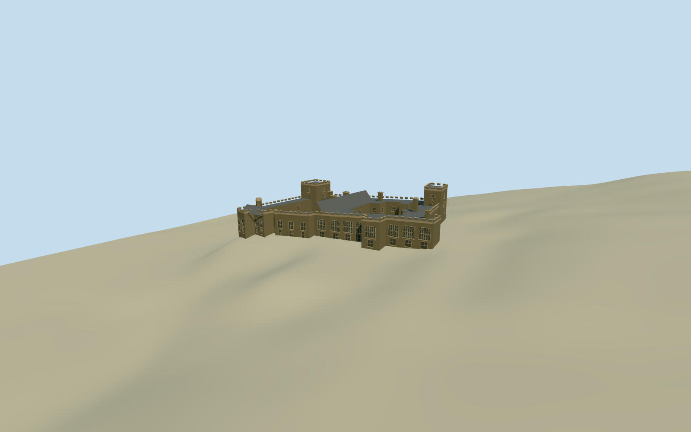

# Haddon Hall

Haddon Hall on its Derbyshire bluff, with two courts, gate tower, chapel, cross-range and the transomed Long Gallery.

Authoring state: **review-in-qa.json**. Current completion evidence is in [qa.json](qa.json) and the [completion ledger](../../../../qualla-structures/batches/qualla-004.PROGRESS.md).

- [Haddon Hall](https://qualla.com/haddon-hall/)

The existing manor and attached chapel. Surrounding garden walls, gatehouse at the road, stables and interior spaces are outside scope.

Current published plans do not give all parapet heights and upper roofs; those are estimated from listing and imagery.

Build: `node content/worldgen/source/places/gc/gcq/haddon_hall/models/generate-haddon-hall.mjs`. Add `--check` to verify exact regeneration. 14056 triangles; 5 materials; no embedded photographs.
